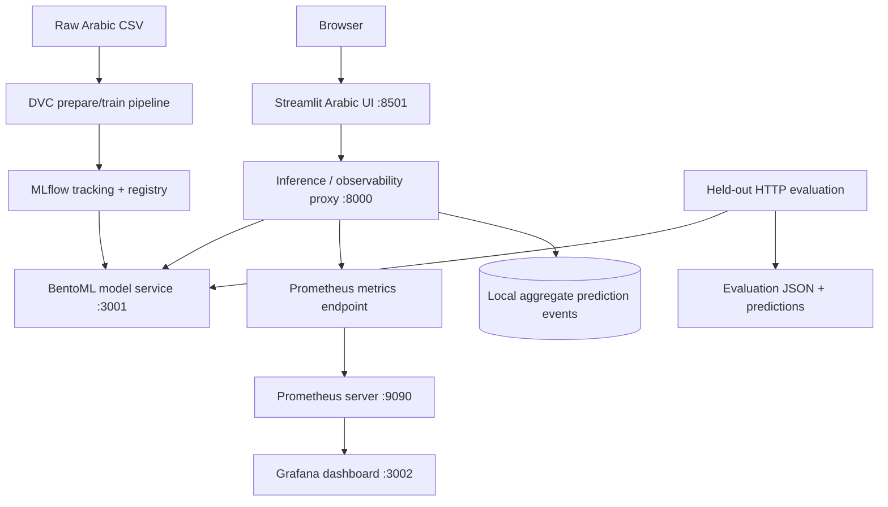

# Arabic Sentiment MLOps — End-to-End Project Report

> **Project snapshot:** 24 October 2026<br>
> **Track:** Deep Learning / Arabic Sentiment Analysis (Track A in *The MLOps Practitioner — Mini Projects & Final Project Handbook*)<br>
> **Repository:** [`MoohamedMahmoud/arabic-sentiment-mlops`](https://github.com/MoohamedMahmoud/arabic-sentiment-mlops)<br>
> **Last historical branch recorded:** `module-3-serving-release`<br>
> **Last historical pushed commit in the retained project record:** `3796ec7` — `feat: finalize Arabic sentiment serving` (not asserted to be the current remote HEAD)

<div align="center">

**Arabic-language review sentiment · AraBERT · Reproducible MLOps pipeline**


</div>

**Document purpose.** This file is the consolidated project story, not just installation instructions. It records why the dataset was selected, what the data notebook discovered, how notebook work became package/DVC/MLflow code, which AraBERT trials were compared, how serving and observability were assembled, what every evaluation actually proved, and which handbook items still require evidence.

> **Current release snapshot (24 October 2026):** the full served evaluation completed for 8,874/8,874 rows and the configured quality gate passed (accuracy 0.8781; macro-F1 0.8702). One failure occurred in the recorded 10-user load test. The proxy, frontend, and MLflow Docker images are published as `v1.0.0`; the approximately 7.8 GB Bento image and pull-only deployment remain deferred. ONNX conversion, class-imbalance/model experiments, and dataset reconciliation are future work.

> **Evidence rule:** the offline test metrics, earlier HTTP smoke test, complete served evaluation, load tests, and runtime batching benchmark are different experiments. They are reported separately. A quality-gate pass is not automatically a production-load qualification.

### Contents

- [1. Executive summary](#1-executive-summary)
- [2. Development environment and setup](#2-development-environment-and-project-setup)
- [3. Business problem and scope](#3-business-problem-and-project-scope)
- [4. Dataset choice, provenance, and papers](#4-dataset-choice-provenance-and-research-context)
- [5. Data understanding and cleaning](#5-data-understanding-and-cleaning-decisions)
- [6. AraBERT trials and offline evaluation](#6-model-training-and-offline-evaluation)
- [7. Package and tests](#7-python-package-repository-structure-and-automated-tests)
- [8. DVC and MLflow](#8-dvc-mlflow-tracking-and-model-registry)
- [9. BentoML packaging and Docker](#9-serving-packaging-mlflow--bentoml--docker)
- [10. UI, proxy, Prometheus, and Grafana](#10-ui-inference-proxy-prometheus-and-grafana)
- [11. Served predictions and evaluation](#11-api-prediction-checks-and-served-model-evaluation)
- [12. GitHub, Docker Hub, and release workflow](#12-github-docker-hub-and-release-workflow)
- [13. Handbook checklist](#13-handbook-requirement-by-requirement-status)
- [14. Runbook](#14-reproducible-local-runbook)
- [15. Remaining work and conclusions](#15-known-gaps-and-prioritized-next-steps)
- [References](#references)
- [Appendix A — Quick-start commands](#appendix-a--quick-start-commands-windows-powershell)

---

## 1. Executive summary

The project develops a three-class Arabic sentiment classifier for Arabic review text. The output is `NEGATIVE`, `NEUTRAL`, or `POSITIVE`, together with a confidence score. AraBERT v0.2 was fine-tuned using PyTorch and Hugging Face Transformers, then integrated into an MLOps workflow with DVC, MLflow, BentoML, a Streamlit UI, a FastAPI inference/observability proxy, Prometheus, Grafana, and Docker Compose infrastructure.

Since the previous report snapshot, the full held-out set of **8,874 examples** has successfully passed through the deployed HTTP path. The served model achieved accuracy **0.8781** and macro-F1 **0.8702**; the configured quality gate passed its macro-F1 and neutral-class F1 thresholds. A separate exploratory batching benchmark also completed 30/30 requests successfully across batch sizes 1, 4, and 8. Load-test evidence shows one HTTP 502/503-related failure during the recorded 10-user run, and the full-evaluation latency tail is high. Therefore, the quality gate passed, but the service is **not qualified for unrestricted production load**.

### Current state at a glance

| Area | Latest verified outcome | Limitation / next step |
|---|---|---|
| Dataset and provenance | Local `data/raw/alldata.csv` audited; repository [BihterDass/ArabicTextClassificationDataset](https://github.com/BihterDass/ArabicTextClassificationDataset) contains the same named CSV set and is associated with co-author Bihter Das | Local snapshot has 110,760 rows and an imbalanced distribution, unlike the paper's description of a 100K balanced per-language dataset; exact snapshot/version and license should be recorded; 88,738 audit rows vs 88,737 prepared split rows needs reconciliation |
| Offline AraBERT model | Accuracy **0.8757**, macro-F1 **0.8681** on 8,874 held-out rows | Offline training used `max_length=160`; the registered served artifact reports `max_length=256`, so keep the results separately labelled |
| Full served evaluation | All **8,874 / 8,874** rows evaluated through `http://127.0.0.1:8000/predict`; accuracy **0.8781**, macro-F1 **0.8702** | Tail latency is high: HTTP batch p95 **9.29 s**, p99 **22.56 s**; timings are per batch of up to eight texts |
| Quality gate | **PASS**: macro-F1 `0.8702` ≥ `0.85`; NEUTRAL F1 `0.8311` ≥ `0.80` | These are project-specific thresholds, not a claim of general production readiness |
| Load test and canary | 4- and 5-user recorded runs had no failures; 10-user run had 1 failure in 196 requests | 10-user reliability is not qualified; 5 users is only a provisional demonstration ceiling, not a sustained-capacity guarantee |
| Runtime benchmark | 10 measured requests each at batch sizes 1, 4, and 8; 30/30 successful; observed throughput rose from `1.2415` to `5.3967` texts/s | Exploratory benchmark only; not the handbook's full optimization benchmark protocol and not evidence of ONNX/TensorRT optimization |
| Python quality | A previous local check recorded Ruff and compile checks passing and **29 tests passing** | Rerun checks on the final working tree before commit; a past pass does not prove the current tree passes |
| DVC / MLflow | DVC pipeline exists; registered model `ArabicSentiment` version `2`; current Bento tag `arabic_sentiment_v2:ui5zcfgkc2qxoaav` | A clean-clone run still depends on dataset/model artifact access and DVC/MLflow configuration |
| Docker Hub | Proxy, frontend, and MLflow images published as `v1.0.0` under `m0hamedseleem` | Bento image remains local and is about **7.8 GB**; pull-only Compose deployment has not been completed or validated |
| GitHub / course release | A feature branch and CI workflow were previously recorded | Current branch, working-tree changes, latest remote commit, CI result, PR merge, and final release tag must be checked locally/on GitHub; do not assume they are complete |

**Central conclusion:** the project now has a complete full-set served-model evaluation and a passing quality gate, in addition to the offline evaluation and integrated serving/monitoring stack. Remaining gaps are operational qualification at higher concurrency, full handbook optimization evidence, final image portability, reproducibility/provenance cleanup, and the GitHub/course release workflow. They are stated explicitly rather than represented as completed work.

## 2. Development environment and project setup

The work was carried out primarily in Windows PowerShell in one Git repository, `arabic-sentiment-mlops`, under the MLOps MENA final-project directory. The repository was cloned from GitHub, so a second `git init` and a manually added `origin` were not needed after cloning. The workflow was to use the existing `main` branch as the base, create a feature branch for the next module, and push/submit changes through a pull request rather than create a separate repository for every stage.

Recorded development environment details:

| Component | Recorded setup |
|---|---|
| OS / shell | Windows, PowerShell |
| Python | 3.12.7, pinned to the Python 3.12 series |
| Package/environment manager | `uv` 0.12.5 |
| Git | 2.39.1.windows.1 |
| Local virtual environment | `.venv` inside the repository |
| GPU reported by `nvidia-smi` | NVIDIA GeForce RTX 3060, 6 GB VRAM |
| Driver-reported CUDA compatibility | CUDA 13.2 (this is what the NVIDIA driver reported; it is not by itself proof that every container uses the GPU) |

The package/environment setup used `uv init --package`, `uv python pin 3.12`, and `uv venv`; `uv.lock` records dependency resolution. Project dependencies include the PyTorch/Transformers/AraBERT training stack, MLflow, DVC, BentoML, FastAPI, Streamlit, and monitoring/testing tools. The direct `pydantic-settings` dependency was added during configuration work. The host GPU made local GPU fine-tuning possible; **do not claim the Docker serving container uses the GPU** unless GPU passthrough and runtime utilization are explicitly configured and measured.

### Conclusion of setup

The work moved into a reproducible package-based project rather than remaining a notebook-only experiment. Windows-specific shell commands and local data/model artifacts remain relevant to reproduction, so commands in this document are PowerShell examples.

---

## 3. Business problem and project scope

### 3.1 Problem statement

A review platform needs to summarize large volumes of Arabic user feedback into positive, neutral, and negative sentiment. A deployed classifier can assist review analysis, product feedback summaries, and prioritization of negative experiences. It must handle Arabic spelling variation, informal language, short ambiguous messages, negation, and mixed sentiment.

### 3.2 Prediction contract

- **Input:** Arabic review text (single review or a batch, depending on endpoint).
- **Output classes:** `NEGATIVE`, `NEUTRAL`, `POSITIVE`.
- **Output fields:** predicted label and confidence; the proxy and service also expose model metadata and health information.
- **Model family:** AraBERT v0.2 sequence classifier, with the implementation and model artifacts managed in the project.
- **Serving path:** Streamlit browser UI → inference proxy → BentoML model service.

This is a three-class **text classification** system, not a generative LLM or a RAG application.

---

## 4. Dataset choice, provenance, and research context

This section deliberately separates the dataset that was discussed during selection from the data that the project actually processed.

### 4.1 Candidate discussed: the KAUST Arabic Sentiment Analysis 2021 competition

One candidate considered during dataset selection was the [Arabic Sentiment Analysis 2021 Competition at KAUST](https://www.kaggle.com/c/arabic-sentiment-analysis-2021-kaust/data). Its overview paper, [*Overview of the Arabic Sentiment Analysis 2021 Competition at KAUST*](https://arxiv.org/abs/2109.14456), describes a three-way sentiment task over **tweets**, not app or product reviews. The competition paper describes 55,000 training tweets, a 20,000-tweet public validation/leaderboard split (`TEST1`), and another 20,000-tweet private test split (`TEST2`). The paper describes the release as a 100K dataset in its abstract, while its split table totals 95,000 examples; when citing the paper's split sizes, the explicit `55K + 20K + 20K` split counts are the most precise description.

The paper also reports **Macro-F1** as the official ranking metric and describes a two-phase competition: public leaderboard evaluation on `TEST1`, then code submitted by top-ranked teams evaluated on the hidden `TEST2`. It notes that top teams commonly used pretrained Arabic transformer models, particularly MARBERT, with preprocessing such as removing URLs, hashtags, user identifiers, and repeated characters. Our project differs in model family (AraBERT v0.2), data domain (reviews, not tweets), and evaluation process. We took the methodological lesson—keep training, validation and final test separate, use a metric that reflects every class, and don't tune against the final test set—not the paper's data or numeric leaderboard results.

**Important distinction:** the `data/raw/alldata.csv` used in this project does **not** look like the KAUST tweet corpus. Its first records are app-style Arabic comments about children's learning applications, with labels such as `NEUTRAL` and `POSITIVE`. Therefore, the KAUST competition was a candidate/reference during research, not a verified source attribution for the corpus ultimately used.

For the final project, one dataset was the more defensible starting point than merging two unrelated corpora: tweets and application reviews differ in genre, length, vocabulary, label source, and likely annotation process. Combining them without a carefully designed domain-generalization experiment could make the results hard to interpret. The final local pipeline therefore uses one locally supplied review corpus; KAUST remains a methodology reference only.

| Dimension | KAUST 2021 paper/competition | This project |
|---|---|
| Text domain | Arabic tweets | App-style Arabic reviews in the local CSV |
| Labels | Positive / Negative / Neutral | `POSITIVE` / `NEGATIVE` / `NEUTRAL` |
| Split strategy described in the source | Public train and validation sets with a separate private leaderboard test set | Audit the supplied files, remove missing/conflicting/duplicate records, then prepare separate train/validation/test splits |
| Dataset used for the reported AraBERT score below? | **No evidence that it was used** | Local `alldata.csv` |
| Score comparability | Not comparable without the same corpus and evaluation protocol | Report metrics against this project's own held-out split |

### 4.2 Actual local data artifact

The raw file inspected in this project is `data/raw/alldata.csv`. It is a headerless UTF-8 CSV with two columns interpreted as `text` and `label`.

The raw file's measured properties are:

| Check | Result |
|---|---:|
| Raw rows | **110,760** |
| Columns | 2 (`text`, `label`) |
| Missing text values | 0 |
| Blank text values | 0 |
| Missing labels | 1 |
| `NEGATIVE` labels | 46,827 |
| `NEUTRAL` labels | 32,129 |
| `POSITIVE` labels | 31,803 |
| Exact-text duplicate rows beyond the first copy | 21,888 |
| Unique exact text values among labeled rows | 88,871 |

The one unlabeled record is not valid supervised training data. The label distribution is also not balanced: the negative class is larger than either neutral or positive.

### 4.3 Dataset repository and associated paper: what matches, and what does not

The GitHub repository used for the project file set is [BihterDass/ArabicTextClassificationDataset](https://github.com/BihterDass/ArabicTextClassificationDataset). Its root contains `alldata.csv`, `train.csv`, `dev.csv`, and `test.csv`, matching the names present in the project's download/workflow history. The repository owner name also corresponds to Bihter Das, co-author of the associated paper by Savci and Das (2023): [*Prediction of the customers' interests using sentiment analysis in e-commerce data for comparison of Arabic, English, and Turkish languages*](https://doi.org/10.1016/j.jksuci.2023.02.017). The publisher's article describes new Arabic, Turkish, and English e-commerce review/complaint datasets and compares traditional ML, deep-learning, and pretrained-language-model approaches.

**Important data-version qualification:** the paper describes each language dataset as approximately 100K samples with equal numbers of positive, negative, and neutral examples. The local `alldata.csv` snapshot audited for this project has **110,760 rows** including one missing label and an imbalanced label distribution (`46,827 NEGATIVE`, `32,129 NEUTRAL`, `31,803 POSITIVE`). Therefore, the repository and paper are the relevant upstream source/publication pair, but the local snapshot's exact identity/version is not demonstrated to be byte-for-byte or distribution-identical to the paper's experimental dataset. This README reports the locally measured counts and does not silently replace them with the paper's reported dataset description. Before redistributing data, verify the repository's license and record the exact file hash/commit used.

#### Paper-to-project comparison

| Dimension | Savci & Das (2023) paper | This project | Interpretation |
|---|---|---|---|
| Task/domain | Three-class sentiment on e-commerce product reviews and complaints in Arabic, English, and Turkish | Three-class Arabic sentiment on the local Arabic review corpus | Same broad task/domain for Arabic, but the exact local snapshot is not confirmed to be identical to the paper's experimental split |
| Dataset scale and balance | Paper describes datasets limited to about 100K samples per language with equal positive/negative/neutral samples | Raw local file: 110,760 rows; class counts are imbalanced; cleaned split total is 88,737, with an audit-preview discrepancy of one row | Do not claim the local snapshot is balanced or exactly the same size as the paper's dataset |
| Methods | Compares traditional ML (e.g. SVM, RF, MNB), deep-learning methods (e.g. CNN/RNN/LSTM), and multiple pretrained language models | Fine-tuned AraBERT v0.2 using PyTorch/Transformers; built DVC/MLflow tracking and a deployed BentoML API | The engineering contribution here is a reproducible deployment/monitoring pipeline around one Arabic transformer model, not a broader model-family comparison |
| Evaluation design | Paper reports a 70/20/10 split and k=10 validation, and compares models within its own dataset/protocol | Stratified train/validation/test split; validation-driven selection; held-out test metrics plus a separate full served-API evaluation | Metrics are not directly comparable unless dataset version, labels, split, preprocessing, and protocol are aligned |
| Reported result | Paper reports 95.1% accuracy for multilingual BERT on its Arabic dataset; it also reports 91.3% for an SVM result in a separate comparison | Offline test: accuracy 0.8757, macro-F1 0.8681; served API: accuracy 0.8781, macro-F1 0.8702 | The paper's accuracy is not a valid baseline for a direct “we improved” claim because the corpus snapshot and evaluation protocol are not proven identical |
| MLOps scope | Primarily a comparative sentiment-analysis experiment | Adds package-based code, DVC, MLflow registry, BentoML, API proxy, UI, Prometheus/Grafana, quality gate, load testing, and container images | These are workflow/deployment contributions, not proof of superior model accuracy versus the paper |

The defensible result is that the project reached **macro-F1 0.8702 on its own complete held-out served evaluation** and passed its configured quality gate, while implementing the MLOps serving and monitoring path. It would be inaccurate to say that it outperformed the paper's 95.1% Arabic accuracy because the evaluation sets and protocols are not comparable. The local neutral class is also the weakest class (`F1=0.8311` in the served evaluation), so further data/imbalance and error-analysis work remains justified.

A separate candidate considered during dataset selection was the [KAUST Arabic Sentiment Analysis 2021 competition](https://www.kaggle.com/c/arabic-sentiment-analysis-2021-kaust/data) and its [overview paper](https://arxiv.org/abs/2109.14456). That is a tweet corpus rather than the e-commerce-review corpus used here. It remains a methodology/reference option for future cross-domain evaluation, not the source of the current local `alldata.csv`.

Other related corpora were considered in the earlier research notes, including [Arabic 100K Reviews by Abed Khooli](https://www.kaggle.com/datasets/abedkhooli/arabic-100k-reviews) and [GLARE: Google Apps Arabic Reviews Dataset](https://arxiv.org/abs/2412.15259). They are useful context or possible future external-evaluation datasets, but neither is claimed as the source of the current `alldata.csv`. A cross-domain evaluation should be kept separate from the primary test set and should not silently mix different domains into training.

### 4.4 Model research reference: AraBERT

The model choice is informed by [Antoun, Baly, and Hajj, *AraBERT: Transformer-based Model for Arabic Language Understanding* (2020)](https://arxiv.org/abs/2003.00104) and the [official AraBERT repository](https://github.com/aub-mind/arabert). AraBERT is a BERT-family model pretrained for Arabic language understanding. Fine-tuning its pretrained representations is more appropriate for this task than training a transformer from scratch on the local labeled data.

The training notebook uses the checkpoint name `aubmindlab/bert-base-arabertv02`, an AraBERT v0.2 sequence-classification setup, and AraBERT preprocessing plus the Hugging Face tokenizer. The pretraining checkpoint's original language-model head is replaced with a newly initialized classification head; Transformers reported missing classifier weights and extra pretraining-head weights at initialization. This is expected when adapting a pretrained language model to a different downstream task, and the new classification head must be learned during fine-tuning.

**Dataset paper vs. model paper:** the KAUST paper describes a different tweet dataset; the AraBERT paper supports the model-family choice. Neither one is currently a verified citation for the provenance of `alldata.csv`.

---

## 5. Data understanding and cleaning decisions

The first data notebook was built as an audit, not as a training notebook. Its purpose was to test assumptions before cleaning and to preserve the original input unchanged.

### 5.1 Checks performed

The audit notebook inspects:

1. File shape, column interpretation, types, and sample records.
2. Missing text, empty text, and missing labels.
3. Label vocabulary and class distribution.
4. Examples sampled from each class to check whether labels appear semantically plausible.
5. Exact duplicate strings.
6. Canonical duplicates, where whitespace is normalized and Arabic diacritics/tatweel are removed **for duplicate detection**.
7. Canonical text groups whose rows have conflicting sentiment labels.
8. Text character/word lengths and rough sequence-truncation pressure.
9. Rating-like leading words (for example, “ممتاز”, “رائع”, “جيد”, and “ضعيف”) to investigate possible label shortcuts.
10. Whether supplied train/dev/test splits overlap with one another and with the all-data artifact.

The audit uses `RANDOM_STATE = 42` for repeatable sampling. Raw input files are not overwritten by the audit.

### 5.2 Why exact and canonical duplicates both matter

Exact duplicate detection catches repeated strings. Canonical duplicate detection additionally catches some surface-form differences caused by whitespace, Arabic diacritics, or tatweel. Repeated review text can make a test score too optimistic if identical or almost-identical entries appear in both training and evaluation. The same canonical text with multiple sentiment labels is also a data-quality problem: it can represent annotation noise, ambiguous wording, or a conflict that needs special handling.

The audit measured:

- **21,888** exact duplicate rows beyond the first occurrence among labeled records, leaving 88,871 unique exact strings.
- **22,002** repeated rows when using the stronger canonical key; **88,757** unique canonical keys before removing conflicting-label groups.
- **19** canonical text keys with conflicting sentiment labels.
- **108** rows belonging to those conflicting canonical-text groups.

### 5.3 Conservative cleaning preview

The audit's recommended policy was:

1. Leave the raw file unchanged.
2. Drop rows with a missing label.
3. Build a canonical-text key for audit and leakage prevention.
4. Exclude every row belonging to a conflicting canonical-text group rather than arbitrarily selecting one of its different labels.
5. Keep one occurrence of each remaining canonical text.
6. Create new stratified train/validation/test splits.
7. Verify that split boundaries do not share duplicate review text.

The notebook reported this progression:

| Stage | Rows |
|---|---:|
| Raw input | 110,760 |
| After excluding missing labels | 110,759 |
| After excluding conflicting canonical-text groups | 110,651 |
| After canonical deduplication (audit preview) | **88,738** |
| Retained from labeled rows | **80.12%** |

Canonical normalization here is a duplicate key, not a promise that the actual model input is fully normalized by all the same transformations. The final model preprocessing uses the AraBERT preprocessor and tokenizer; these are model-input steps and should remain consistent between training and inference.


### 5.3.1 Length analysis and rating-headline / shortcut checks

The notebook measured text length before selecting a model token limit. The cleaned audit preview had a long-tailed length distribution:

| Statistic | Character count | Whitespace-separated words |
|---|---:|---:|
| Median (P50) | 70 | 13 |
| P90 | 309 | 58 |
| P95 | 556 | 105 |
| P99 | 1,543 | 295 |
| Maximum | 7,858 | 1,485 |

Word count is only a rough proxy for subword tokens. In the AraBERT baseline notebook, the **actual tokenizer** gave a P95 length of **132 tokens**. Rounding upward to the next multiple of 32 led to a selected `max_length=160`; the reported estimated truncation rate at that limit was **3.88%**. This is the data-driven reason recorded for the training length, not an arbitrary default. The serving metadata currently reports length 256, so this remains a model-serving configuration parity item rather than proof that the training choice was 256.

The audit also investigated whether the corpus contains sentiment-bearing words at the start of reviews that might behave like rating headings. **18,458 rows (16.67% of labeled rows)** began with one of the tested phrases (`مخيب للأمل`, `مخيب`, `ضعيف`, `مقبول`, `مرضي`, `جيد`, `رائع`, `ممتاز`, `استثنائي`). Among these, the class counts were 7,744 negative, 5,900 neutral, and 4,814 positive. These phrases can be genuine user language as well as a possible shortcut signal, so the notebook measured and sampled them rather than blindly stripping them.

The packaged `prepare.py` cleaning policy does **not** apply a global headline-stripping rule. It preserves the review text except for trimming outer whitespace; its deterministic cleaning focuses on missing/unknown labels, conflicting canonical groups, and duplicate canonical texts. Shortcut removal remains an experiment that would require a controlled comparison on the same held-out evaluation set before adopting it.

### 5.4 Why the originally supplied splits were not trusted unchanged

The audit also inspected the original files that arrived with the GitHub-hosted data: `train.csv`, `dev.csv`, and `test.csv`. The notebook reported these sizes and cross-split canonical-key overlaps:

| Original supplied file | Rows | Audit finding |
|---|---:|---|
| `train.csv` | 87,334 | Shared 7,918 canonical text keys with `dev`; 1,195 with `test` |
| `dev.csv` | 9,991 | Shared 7,918 canonical text keys with `train`; 3 with `test`; three train/dev overlapping texts had conflicting labels |
| `test.csv` | 10,015 | Shared 1,195 canonical text keys with `train`; 3 with `dev` |

The notebook also found records in each supplied split whose canonical keys were absent from `alldata.csv` (56 train, 89 dev, and 8 test keys). This points to duplicated content and a possible corpus/version mismatch between the all-data file and the provided split files. These original file counts are audit observations, not the final train/validation/test counts used for the reported offline results.

Because split overlap can leak repeated text across evaluation boundaries, the project did not blindly accept the original split files as the final model evaluation setup. Instead, we treated `alldata.csv` as the raw input for our reproducible preparation process, investigated conflicting labels and duplicate texts, and created new stratified splits. The final training notebook loads the prepared Parquet files and explicitly checks that text overlap between train, validation, and test is zero. Its recorded counts are:

| Prepared split | Rows | Percentage of 88,737 |
|---|---:|---:|
| Train | 70,989 | 80% |
| Validation | 8,874 | 10% |
| Test | 8,874 | 10% |
| **Total** | **88,737** | **100%** |

The notebook's exact-text train/validation/test overlap check passed with zero pairwise overlap.

**One reproducibility discrepancy remains:** the cleaning audit preview produced 88,738 rows, while the prepared model splits total 88,737 rows. Their class counts differ by one negative example. This is small but should be reconciled in the preparation/data-card workflow before treating the pipeline as completely frozen.

### 5.5 Prepared label distribution

| Split | `NEGATIVE` | `NEUTRAL` | `POSITIVE` | Total |
|---|---:|---:|---:|---:|
| Train | 33,107 | 20,215 | 17,667 | 70,989 |
| Validation | 4,138 | 2,527 | 2,209 | 8,874 |
| Test | 4,139 | 2,527 | 2,208 | 8,874 |
| **Total** | **41,384** | **25,269** | **22,084** | **88,737** |

The prepared dataset remains class-imbalanced, especially with more negative than positive examples. Accuracy alone would hide some class-specific weaknesses, so macro-F1 and per-class F1 are reported as well.

### 5.6 Conclusion of the data stage

The original file was not ready for a trustworthy experiment simply because it had three labels and train/dev/test files already existed. It contained a missing label, substantial duplicate text, conflicting labels for some canonicalized texts, and supplied splits with large overlap. The main conclusion was to **audit first, keep raw data immutable, and recreate the split boundaries from the all-data file rather than assume that inherited CSV splits are leakage-free**. Rebuilding the splits after cleaning and explicitly checking overlap made model evaluation more defensible. Remaining actions are recovering the exact upstream GitHub URL/license and reconciling the one-row count discrepancy.

---

## 6. Model training and offline evaluation

### 6.1 Training methodology

The baseline notebook, `02-arabert-baseline.ipynb`, follows this flow:

`prepared train/validation/test → AraBERT preprocessing → tokenizer → GPU fine-tuning → validation model selection → final held-out test evaluation → saved model/report`

Key methods and settings recorded in the notebook/logs:

- Pretrained checkpoint: `aubmindlab/bert-base-arabertv02`.
- Frameworks: PyTorch, Hugging Face Transformers, Datasets, scikit-learn, and AraBERT preprocessing.
- Seed: `42` for Python, NumPy, and the training framework.
- Evaluation metrics: accuracy, macro-F1, per-class precision/recall/F1, confusion matrix, and loss.
- Selected run: learning rate `2e-5`, 3 epochs, maximum sequence length `160`.
- Recorded training configuration from the project's config: train batch size `4`, evaluation batch size `8`, gradient accumulation `4`, weight decay `0.01`, random seed `42`.
- Training split: 70,989 examples.
- Validation split: 8,874 examples.
- Held-out test split: 8,874 examples.
- Hyperparameter selection: compare learning rate, epoch count, and maximum sequence length; choose the checkpoint using validation Macro-F1 rather than choosing settings from test metrics.

### 6.2 Tuning trials captured in the training log

| Trial | Learning rate | Epochs | `max_length` | Validation accuracy | Validation macro-F1 | Validation loss | Training time |
|---|---:|---:|---:|---:|---:|---:|---:|
| Previously saved baseline | 2e-5 | 2 | 160 | 0.873112 | 0.866439 | 0.344909 | Not recorded |
| `trial_01_lr_1e-5` | 1e-5 | 2 | 160 | 0.865450 | 0.857881 | 0.351227 | 70.5 min |
| `trial_02_lr_3e-5` | 3e-5 | 2 | 160 | 0.875704 | 0.868894 | 0.358200 | 57.2 min |
| `trial_03_epochs_3` | 2e-5 | 3 | 160 | **0.876944** | **0.869857** | 0.435325 | 92.3 min |
| `trial_04_max_length_256` | 2e-5 | 2 | 256 | 0.874352 | 0.867409 | **0.336041** | 57.1 min |

**Comparison against the saved baseline:**

| Trial | Δ validation accuracy | Δ validation macro-F1 | Interpretation |
|---|---:|---:|---|
| `trial_01_lr_1e-5` | -0.007662 | -0.008558 | Weaker accuracy and Macro-F1 under the recorded two-epoch budget; not selected |
| `trial_02_lr_3e-5` | +0.002592 | +0.002455 | Stronger and faster two-epoch option; close second on Macro-F1 |
| `trial_03_epochs_3` | **+0.003832** | **+0.003418** | **Selected:** highest validation accuracy and Macro-F1 in the recorded sweep |
| `trial_04_max_length_256` | +0.001240 | +0.000970 | Lowest validation loss, but lower Macro-F1 than trials 2 and 3 |

`trial_03_epochs_3` gained **0.003418 Macro-F1** (about **0.34 percentage points**) and **0.003832 accuracy** (about **0.38 percentage points**) over the saved baseline, at a recorded training time of 92.3 minutes. Compared with `trial_02_lr_3e-5`, the Macro-F1 gain was only 0.000963 (about 0.10 percentage points) for roughly 35.2 additional minutes. Thus, trial 2 is a reasonable lower-cost near-best alternative, though trial 3 won by the project's chosen validation selection metric.

The `max_length=256` trial produced the lowest validation loss but did not achieve the strongest accuracy or Macro-F1. This is why selection used validation Macro-F1 rather than loss alone. The recorded sweep does **not** prove that longer inputs are universally worse; it only shows that `max_length=256` did not win in these particular settings. Trial 3's higher loss despite the strongest Macro-F1 is also a reason to inspect calibration and error patterns rather than assume one metric tells the whole story.

#### How this compares with the paper/split decision

The KAUST competition paper was considered as a benchmark reference, but it describes a tweet dataset and its own public development/private test setup, not our local review CSV. We did **not** import its split sizes or compare scores directly with its leaderboard. For this project we used the audited `alldata.csv`, made new leak-checked 80/10/10 splits, selected settings on validation Macro-F1, and used the 8,874-row test split only for the final offline report. This is the part of the methodology we adopted: preserve a held-out evaluation set and do not tune against it—not claim a paper-to-paper numerical comparison across different data.

### 6.3 Held-out test results for the selected offline checkpoint

The saved tuning output records the following metrics on the 8,874-row test split:

| Metric | Value |
|---|---:|
| Test accuracy | **0.8757** |
| Test macro-F1 | **0.8681** |
| Test loss | **0.4389** |
| Weighted F1 | 0.8761 |

Per-class results:

| Class | Precision | Recall | F1 | Support |
|---|---:|---:|---:|---:|
| `NEGATIVE` | 0.9223 | 0.9007 | **0.9114** | 4,139 |
| `NEUTRAL` | 0.8163 | 0.8421 | **0.8290** | 2,527 |
| `POSITIVE` | 0.8607 | 0.8673 | **0.8640** | 2,208 |
| **Macro average** | 0.8664 | 0.8700 | **0.8681** | 8,874 |
| **Weighted average** | 0.8768 | 0.8757 | 0.8761 | 8,874 |

Confusion matrix (rows = true label, columns = predicted label):

| True \ Predicted | `NEGATIVE` | `NEUTRAL` | `POSITIVE` |
|---|---:|---:|---:|
| `NEGATIVE` | 3,728 | 292 | 119 |
| `NEUTRAL` | 208 | 2,128 | 191 |
| `POSITIVE` | 106 | 187 | 1,915 |

### 6.4 Interpretation and conclusion

- **Negative sentiment was the strongest class**, with F1 0.9114.
- **Neutral was the weakest class**, with F1 0.8290. This is an important focus for error analysis because short or mixed Arabic comments can be ambiguous, and the class boundary between neutral and polar sentiment can be subtle.
- The confusion matrix shows neutral examples being predicted as negative or positive, and negative/positive examples sometimes moving into neutral.
- Macro-F1 (0.8681) is useful alongside accuracy because it gives the three classes equal weight rather than letting the largest class dominate.
- These results show that the selected offline checkpoint learned a useful classifier. They do not, by themselves, prove parity with the MLflow model currently served by BentoML.

### 6.5 Model/preprocessing parity caveat

The selected offline tuning configuration used `max_length=160`. The current BentoML metadata reports `max_length=256` for registered MLflow model version 2. That mismatch means the deployed artifact and tuning report must be checked for identity and preprocessing parity before the offline metrics are attributed to the service. It may be an artifact/version/configuration difference; current evidence does not justify assuming that the mismatch has no effect.

A previous exported baseline notebook also contains an earlier result around accuracy 0.8730 and macro-F1 0.8663. The newer tuning log contains 0.8757 / 0.8681. The saved tuning report is used above as the principal offline result, but only one canonical training report and artifact hash should be treated as the release record.

---

## 7. Python package, repository structure, and automated tests

The project was moved from experimentation toward a reusable package using a `src/` layout, `pyproject.toml`, `uv.lock`, and a Python 3.12 environment. The work was done in Windows PowerShell with `uv` managing dependencies and project execution.

Relevant project conventions:

- `src/arabic_sentiment_mlops/` contains reusable application/model code rather than placing all logic in notebooks.
- A model class loads tokenizer/model assets and centralizes prediction behavior.
- Type hints and explicit label mappings (`NEGATIVE=0`, `NEUTRAL=1`, `POSITIVE=2`) make the inference contract clearer.
- `predict.py` adapts the registered MLflow model for the project-facing predictor interface.
- `mlflow_model.py` defines the MLflow pyfunc wrapper and routes DataFrame/Series inputs to batch prediction.
- The batch prediction path tokenizes a list of texts with padding, performs a single model forward pass under `torch.inference_mode()`, computes probabilities, and returns per-text labels/confidence.
- `pydantic-settings` was added as a direct dependency for configuration handling.
- Raw data, `.env` credentials, virtual environments, model caches, and generated files should not be committed indiscriminately.

### 7.1 Code checks completed

The following commands were run successfully during the most recent code-quality pass:

```powershell
uv run ruff format src/arabic_sentiment_mlops/predict.py src/arabic_sentiment_mlops/model.py
uv run ruff check src/arabic_sentiment_mlops
uv run python -m compileall src/arabic_sentiment_mlops
uv run pytest -q
```

Recorded outputs:

- Ruff formatting: 2 files left unchanged.
- Ruff linting: `All checks passed!`
- `compileall`: completed successfully.
- Pytest: **29 passed, 1 warning, in 11.30 seconds**.
- Warning: `StarletteDeprecationWarning` indicates use of `httpx` with `starlette.testclient` is deprecated and suggests `httpx2`. It did not fail the test suite; it remains a dependency/test cleanup item.

These checks establish useful local code quality. The later full served-model quality gate passed, but the load tests still show a reliability limitation at ten concurrent users.


### 7.2 Component map: what each area owns

| Path / component | Responsibility | Evidence and boundaries |
|---|---|---|
| `src/arabic_sentiment_mlops/` | Reusable data preparation, preprocessing, model class, predictor and MLflow pyfunc wrapper | Source code used by training/serving; the local quality pass covered the package |
| `data/raw/alldata.csv` | Original GitHub-sourced input artifact | Raw data is local/DVC-managed and must not be added to Git as a normal source file |
| `data/processed/*.parquet` | Prepared train/validation/test splits | Generated by the DVC preparation stage; the current 88,737-row total needs reconciliation with the 88,738-row audit preview |
| `dvc.yaml` | Data preparation and training pipeline graph | `uv run dvc status` and `uv run dvc repro` are the normal inspection/reproduction commands |
| `serving/service.py`, `serving/import_model.py`, `bentofile.yaml` | Load the registered MLflow model into BentoML and define the service/container build | Current container image is `arabic-sentiment-service:vetbwwgkosur4aav` |
| `ui/` | Streamlit user experience for entering Arabic text and displaying label/confidence | The folder existed locally as untracked at the latest recorded Git status; include it deliberately in the final PR |
| `monitoring/api_proxy.py` | Proxy for prediction/metadata/health plus aggregate telemetry | Upstream metadata call was corrected to use POST; proxy responds on port 8000 |
| `monitoring/prometheus.yml`, `monitoring/grafana/`, `monitoring/alerts.yml` | Prometheus scrape configuration, provisioned Grafana dashboard/datasource, and alert definitions | Files exist; a file existing does not prove every alert is routed or tested end-to-end |
| `docker/docker-compose.yml` | MLflow + PostgreSQL + RustFS infrastructure | Separate Compose project; keep it separate from the UI/observability stack |
| `docker/docker-compose.observability.yml` | UI + inference proxy + Prometheus + Grafana | Does not require rebuilding when only the Bento model image changes |
| `scripts/evaluate_served_model.py`, `scripts/quality_gate.py` | Evaluate real HTTP predictions and enforce minimum quality thresholds | Full 8,874-row evaluation completed and passed the configured quality gate; tail latency remains high |
| `loadtest/locustfile.py`, `reports/locust/` | Synthetic load and performance evidence | Reports exist for 2, 3, 4, 5, and 10 users; the recorded 10-user run had one failure in 196 requests |
| `docs/`, `reports/` | Runbook, integration map, evaluation output and supporting evidence | Keep smoke-test artifacts labelled as smoke tests; do not replace with partial results and call them final |
| `.github/workflows/ci.yml` | GitHub Actions CI definition | Local test pass is confirmed; a green remote Actions run is not yet confirmed |

At the time of the historical `3796ec7` commit, not every working-copy file was included: `ui/` was untracked, `src/arabic_sentiment_mlops/model.py` was modified but unstaged, and the comprehensive root README was not included in that commit. The current Git state has not been verified by this document; inspect it before staging. Exclude local Word documents, `.bak` files, secrets, virtual environments, and raw data.

---

## 8. DVC, MLflow tracking, and model registry

### 8.1 DVC data and pipeline versioning

The project uses DVC to describe data preparation and training stages in `dvc.yaml`. The preparation stage is recorded as:

```powershell
uv run python -m arabic_sentiment_mlops.prepare --input data/raw/alldata.csv --output data/processed --seed 42
```

Its documented outputs include Parquet train, validation, and test artifacts plus a `data_card.json` provenance artifact. The data card records the raw-file SHA-256, preparation seed, allowed sentiment labels, cleaning counts, split row counts, and per-split label distributions. The training stage is also described in the DVC pipeline, with source code and prepared data as dependencies. DVC is intended to make the data/model workflow explicit and reproducible, rather than relying on undocumented notebook state.

Useful commands:

```powershell
uv run dvc status
uv run dvc repro
```

A clean clone can reproduce the workflow only if its raw data and DVC remote artifacts are actually available and the necessary remote credentials are configured. Do not commit `.env`, object-store keys, or other secrets to make a local run work.

### 8.2 MLflow experiments and registry

MLflow is used to record experiments, store model artifacts, and register the selected model. The registered model observed in the live service metadata is:

- Registered model: `ArabicSentiment`
- Model version: `2`
- Bento's bundled model tag: `arabic_sentiment_v2:ui5zcfgkc2qxoaav`

The local infrastructure uses PostgreSQL as the MLflow backend store and RustFS as an S3-compatible artifact store. The MLflow tracking UI is exposed on `127.0.0.1:5000`; RustFS is exposed locally on ports `9000–9001`; PostgreSQL uses internal port `5432` in the Compose network.

### 8.3 Infrastructure startup

The MLflow infrastructure is a separate Compose project from the serving/observability stack:

```powershell
docker compose --env-file .env -f docker/docker-compose.yml --project-directory . up -d
```

The runtime checks recorded MLflow and PostgreSQL as healthy, and RustFS as running. The `create-mlflow-bucket` initialization container exits after its one-time task, which is expected for a setup job.

### 8.4 Conclusion of tracking/versioning stage

Experiment tracking and registry registration exist, and version 2 is being loaded into BentoML. The remaining reproducibility item is to connect a single immutable model artifact/checkpoint hash to the offline evaluation, the MLflow registry version, the Bento bundle, the served evaluation report, and the release tag. Until that chain is explicit, offline and online scores should be reported separately.

---

## 9. Serving packaging: MLflow → BentoML → Docker

### 9.1 A real packaging failure and its fix

An earlier BentoML container failed during startup with `ModuleNotFoundError: No module named 'arabic_sentiment_mlops'`. The serialized MLflow pyfunc model imports project Python code during load, so installing only the public runtime packages was insufficient: the application package also needed to be available inside the Bento container.

The packaging was corrected by building the local project wheel and adding it to the Bento build:

```powershell
uv build --wheel
New-Item -ItemType Directory -Force .\wheels | Out-Null
Copy-Item .\dist\arabic_sentiment_mlops-*.whl .\wheels\ -Force
uv run bentoml build
```

The observed SHA-256 for the copied wheel was:

```text
ED3D0F3B8D8E2A7F003CC604AF399A45DA33E0C815C53ECEFB2A8CD6EAC8027B
```

BentoML then built:

```text
arabic-sentiment-service:vetbwwgkosur4aav
```

Containerization completed successfully with:

```powershell
uv run bentoml containerize arabic-sentiment-service:vetbwwgkosur4aav
```

The `wheels/` file may be ignored by Git; on a clean checkout, build the wheel and copy it into the expected `wheels/` path before invoking `bentoml build`. A small build script would be a better long-term reproducibility improvement than relying on someone remembering these manual steps.

### 9.2 Current serving configuration

The latest live container is named `arabic-sentiment-bento` and uses image `arabic-sentiment-service:vetbwwgkosur4aav`. It exposes container port `3000` on host port `3001`. The preceding container was renamed to `arabic-sentiment-bento-previous` and stopped, rather than deleted, so the older image/container remains available as a rollback option.

The new service returned HTTP 200 at `/readyz` and returned the following metadata through `POST /metadata`:

| Setting | Reported value |
|---|---|
| Service | `arabic-sentiment-service` |
| MLflow registered model | `ArabicSentiment` |
| MLflow model version | `2` |
| Bundled Bento model tag | `arabic_sentiment_v2:ui5zcfgkc2qxoaav` |
| Maximum sequence length in service metadata | `256` |
| Adaptive batch maximum size | `8` |
| Adaptive batch latency setting | `2000 ms` |

The BentoML service uses a batchable prediction API, loads the MLflow model at service initialization, validates/strips incoming texts, and returns labels with confidence values. Its exact behavior is implemented in `serving/service.py`.

### 9.3 Why adaptive batching was changed

An earlier service configuration reported a maximum batching latency of `100 ms`; the latest build reports `2000 ms` with `max_batch_size=8`. Vectorized inference was also introduced in the model class to avoid implementing a batch as a loop of one-row forward passes. The intent was to reduce repeated model-call overhead and improve the serving behavior under a sustained evaluation.

This was a reasonable optimization hypothesis. The complete 8,874-row evaluation later succeeded with retries, but the high batch-latency tail and one 10-user load-test failure show that stable operation under load is not yet qualified. The separate runtime benchmark shows higher throughput for larger client batches; it does not isolate the effect of the adaptive-batching setting or prove production capacity.

---

## 10. UI, inference proxy, Prometheus, and Grafana

### 10.1 Service architecture



This separation was intentional. Streamlit provides the user-facing application; the proxy mediates requests and captures serving telemetry; BentoML serves the registered model; Prometheus scrapes metrics; Grafana presents a version-controlled dashboard. MLflow/PostgreSQL/RustFS make up a separate experiment/artifact infrastructure stack.

### 10.2 Local endpoints

| Component | Address | Purpose |
|---|---|---|
| Streamlit Arabic sentiment UI | `http://127.0.0.1:8501` | User-facing prediction interface |
| Inference proxy health | `http://127.0.0.1:8000/health` | Proxy and upstream health |
| Proxy metadata | `http://127.0.0.1:8000/metadata` | Upstream model metadata through proxy |
| Prometheus metrics from proxy | `http://127.0.0.1:8000/metrics` | Request/model metrics for scraping |
| BentoML readiness | `http://127.0.0.1:3001/readyz` | Model service readiness |
| Prometheus UI | `http://127.0.0.1:9090` | Metrics exploration/target health |
| Grafana UI | `http://127.0.0.1:3002` | Dashboard |
| MLflow UI | `http://127.0.0.1:5000` | Experiments/model registry |
| RustFS console / API | `http://127.0.0.1:9001` / `http://127.0.0.1:9000` | S3-compatible model artifact storage |

The observed loopback endpoint checks returned HTTP 200 for the proxy health, Streamlit root, Prometheus health, Grafana health API, and MLflow health. These checks confirm that endpoints responded at that time; they do not prove that the full model evaluation is stable or that every UI interaction has been tested.

### 10.3 Metrics and privacy approach

The proxy records aggregate serving telemetry including request/error counts, end-to-end proxy latency, predicted label distribution, confidence, input text-length distribution, and a Population Stability Index (PSI) signal for drift monitoring. The design avoids persisting the raw review text in the telemetry store. This reduces the risk of retaining users' potentially sensitive feedback unnecessarily.

Prometheus is intended for continuous operational metrics. Grafana dashboard JSON and data-source/dashboard provisioning YAML are checked into the repository so dashboards can be recreated as code. A static alerts file exists, but its presence alone is not proof of working Alertmanager routing, Slack/email notification delivery, or a validated alert-response process.

The reference distribution is deliberately not to be updated from a small smoke test. A successful evaluation of the entire held-out test set is the intended source for the initial drift reference. PSI is an early-warning distribution measure, not a substitute for labeled model-quality evaluation.

### 10.4 Metadata-proxy integration bug

The proxy originally issued `GET /metadata` to BentoML, but the Bento metadata endpoint in this implementation accepts `POST`. That produced an upstream `405` and caused a proxy failure. The proxy handler was changed to post an empty JSON body upstream. A subsequent `Invoke-RestMethod http://127.0.0.1:8000/metadata` returned the registered model and batching metadata. This illustrates why integration tests should exercise the actual upstream method and schema, not merely assume that similarly named routes share the same HTTP verb.

### 10.5 Start the separate UI/observability stack

The UI/proxy/Prometheus/Grafana services are launched separately from MLflow/PostgreSQL/RustFS:

```powershell
docker compose -f docker/docker-compose.observability.yml up -d --build
```

The Compose file binds user-facing ports to loopback for local development. Change default Grafana credentials before any shared or exposed deployment; localhost demo credentials are not production secrets or a production access-control strategy.

---

## 11. API prediction checks and served-model evaluation

### 11.1 Small prediction checks and the earlier smoke test

Arabic strings were sent through both the direct BentoML endpoint and the proxy. UTF-8 input encoding worked, and direct/proxy outputs agreed for the same examples. Clearly positive and negative examples were classified accordingly; one short example intended as neutral was classified as `NEGATIVE` with high confidence. Agreement between direct service and proxy confirms the request path, not the correctness of that neutral prediction. Confidence is not the same as correctness or calibration.

#### Historical 32-row smoke test (retained for traceability)

The earlier subset run used batch size 4:

```powershell
# Historical smoke-test command; this is not the full evaluation.
uv run python scripts/evaluate_served_model.py --limit 32 --batch-size 4
```

| Metric | Historical smoke-test result |
|---|---:|
| Rows evaluated | 32 |
| Accuracy | 0.7500 |
| Macro-F1 | 0.7579 |
| NEGATIVE F1 | 0.7500 |
| NEUTRAL F1 | 0.6667 |
| POSITIVE F1 | 0.8571 |
| HTTP batch-latency p50 | 2.1068 s |
| HTTP batch-latency p95 | 2.3534 s |
| HTTP batch-latency p99 | 2.4306 s |
| Mean HTTP batch latency | 2.0254 s |

These latencies are seconds per HTTP batch, not per item. Because the run evaluated only 32 rows, it was useful for checking request/response plumbing but not for estimating final model quality. That subset run did not update `monitoring/reference_distribution.json`.

#### Earlier full-evaluation failures and diagnosis (historical)

Before the successful full run below, the evaluator was attempted with five retries and failed around 200 rows in one attempt and around 1,400 / 8,874 rows in a later attempt. The reported exception was:

```text
RuntimeError: HTTP 502: {"detail":"BentoML returned HTTP 503."}
Request failed after 6 attempts
```

BentoML logs reported `bentoml.exceptions.ServiceUnavailable: process is overloaded`, with cancelled batched requests and HTTP 503 responses after roughly 2.3–2.7 seconds. Individual requests and metadata could still return HTTP 200, so health checks and single predictions had not exposed the saturation behavior. This was evidence of overload/dispatcher pressure, not proof of one definitive root cause.

At that earlier point, the quality gate correctly rejected the incomplete report with `Quality gate requires a complete held-out test-set evaluation, not a smoke-test subset.` The later full run with retries processed all 8,874 rows and passed the gate, as recorded in the next section. The retries enabled completion; they did not prove the overload/latency issue was eliminated.

### 11.2 Full held-out API evaluation — completed

The full test set was successfully evaluated through the deployed proxy:

```powershell
# Run from the repository root after BentoML and the proxy are healthy.
uv run python scripts/evaluate_served_model.py `
  --api-url http://127.0.0.1:8000/predict `
  --test-path data/processed/test.parquet `
  --batch-size 8 `
  --retries 10 `
  --timeout 180
```

The evaluator processed **8,874 / 8,874** rows and wrote:

- `reports/serving/api_evaluation.json` — aggregate metrics and completeness flag;
- `reports/serving/api_test_predictions.csv` — predictions for the held-out examples;
- `monitoring/reference_distribution.json` — updated reference distribution after the complete run.

| Metric | Full served result |
|---|---:|
| Test rows | **8,874 / 8,874** |
| Accuracy | **0.8781** |
| Macro-F1 | **0.8702** |
| NEGATIVE F1 | 0.9139 |
| NEUTRAL F1 | 0.8311 |
| POSITIVE F1 | 0.8654 |
| HTTP batch latency p50 | 2.99 s |
| HTTP batch latency p95 | 9.29 s |
| HTTP batch latency p99 | 22.56 s |
| Mean HTTP batch latency | 3.98 s |

Latency is measured **per HTTP request/batch of up to eight texts**, not per individual text. The evaluator used retries because the serving stack had previously returned transient HTTP 502/503 overload responses. Completion proves that the full evaluation eventually succeeded; it does not prove that overload or tail latency has been resolved.

### 11.3 Quality gate — passed

The configured project thresholds are macro-F1 ≥ `0.85` and neutral-class F1 ≥ `0.80`. Run the gate with:

```powershell
# Validate the complete evaluation artifact against the configured thresholds.
uv run python scripts/quality_gate.py reports/serving/api_evaluation.json
```

Recorded outcome:

```text
macro-F1=0.8702 (minimum 0.8500)
NEUTRAL F1=0.8311 (minimum 0.8000)
QUALITY GATE PASSED
```

The gate pass applies to the current served evaluation artifact and the configured quality thresholds. It is not a latency SLO or production-capacity sign-off.

### 11.4 Model/configuration parity caveat

The offline selected training configuration used `max_length=160`, while the currently bundled MLflow/Bento artifact reports `max_length=256`. Therefore, the offline and served metrics are presented separately. The deployed artifact's recorded `max_length=256` matches the Bento service's serving metadata; this does not prove that the offline checkpoint and served artifact are identical in every other respect. Future comparisons should record the checkpoint/run ID, MLflow version, Bento model tag, preprocessing/tokenizer, and maximum sequence length together.

### 11.5 Load testing and canary qualification

The recorded Locust workload tests single predictions, batches of 2–8 texts, and health checks. These are existing results; no additional load test is implied by this README.

| Concurrent users | Duration | Requests | Failures | Recorded latency evidence |
|---:|---:|---:|---:|---|
| 4 | 60 s | 88 | 0 | Average about 560 ms; p95 about 880 ms; maximum about 973 ms |
| 5 | 60 s | 103 | 0 | Average about 708 ms; p95 about 1,100 ms; maximum about 1,311 ms |
| 10 | 60 s | 196 | 1 (0.51%) | Average about 818 ms; p95 about 1,800 ms; p99 about 2,700 ms; maximum about 2,915 ms; one proxy HTTP 502 / BentoML HTTP 503 |

The BentoML logs identified `bentoml.exceptions.ServiceUnavailable: process is overloaded`. A point-in-time Docker resource snapshot showed BentoML at approximately `847.5 MiB` and the proxy at `40.79 MiB`; this was not a peak-under-load resource measurement. HTML/CSV reports are stored in `reports/locust/`. The qualification notes are recorded in `reports/serving/canary_qualification.md`.

**Canary decision:** NO-GO for an unrestricted production claim at ten concurrent users. Five users is only a provisional ceiling for a controlled demonstration based on the observed run, not a guaranteed sustained capacity. A future promotion should specify acceptable error rate and latency limits and capture resource measurements under the target workload.

### 11.6 Runtime batching benchmark

The exploratory script `scripts/benchmark_served_model.py` sends requests through the existing proxy, uses no retries so failures remain visible, and saves `reports/serving/runtime_benchmark.json`. The recorded run used ten measured requests per client batch size; all 30 requests succeeded.

```powershell
# Re-run only when the model/service or benchmark setup changes; this is a small exploratory run.
uv run python scripts/benchmark_served_model.py --requests-per-size 10
```

| Client batch size | Successful requests | Throughput (texts/s) | Request p50 | Request p95 |
|---:|---:|---:|---:|---:|
| 1 | 10/10 | 1.2415 | 0.726 s | 1.072 s |
| 4 | 10/10 | 3.5316 | 1.080 s | 1.723 s |
| 8 | 10/10 | 5.3967 | 1.609 s | 1.754 s |

Batch size 8 achieved about **4.35× the observed throughput** of batch size 1 in this small run, while the request itself took longer because it carried more texts. This supports client batching as a throughput technique; it does not isolate the effect of the adaptive-batching setting, establish a production SLO, or complete the handbook's optimization journey.

### 11.7 Conclusion of serving validation

- The full 8,874-row HTTP evaluation completed and its quality gate passed.
- The current service can return valid predictions and the proxy path works.
- Transient 502/503 overload responses occurred during prior sustained requests; retries made the complete evaluation finish.
- Tail latency remains high, and the recorded 10-user load test had one failure in 196 requests.
- **Quality acceptance passed; unrestricted production-load qualification did not.**

---

## 12. GitHub, Docker Hub, and release workflow

The previously confirmed feature-branch milestone was `module-3-serving-release` at commit `3796ec7` (`feat: finalize Arabic sentiment serving`). This is historical context, not a claim that it is still the current branch or latest remote commit. Check the current state with `git branch --show-current`, `git status --short`, and `git log -5 --oneline` before finalizing. The earlier Module 2 tag `v0.2.0` should not be overwritten.

A GitHub Actions workflow exists at `.github/workflows/ci.yml`, but the workflow file itself does not prove a green remote Actions run. Verify the Actions tab and the PR status before claiming CI passed, PR merged, or a release tag created.

### Docker Hub images published

The following three supporting images were successfully pushed to Docker Hub under `m0hamedseleem` with tag `v1.0.0`:

| Component | Published image | Approximate local image size at push |
|---|---|---:|
| Inference proxy | [`m0hamedseleem/arabic-sentiment-inference-proxy:v1.0.0`](https://hub.docker.com/r/m0hamedseleem/arabic-sentiment-inference-proxy) | 162 MB |
| Streamlit frontend | [`m0hamedseleem/arabic-sentiment-frontend:v1.0.0`](https://hub.docker.com/r/m0hamedseleem/arabic-sentiment-frontend) | 563 MB |
| MLflow | [`m0hamedseleem/arabic-sentiment-mlflow:v1.0.0`](https://hub.docker.com/r/m0hamedseleem/arabic-sentiment-mlflow) | 955 MB |

The Bento image is locally available as `arabic-sentiment-service:vetbwwgkosur4aav` (approximately **7.8 GB**) and was locally tagged as `m0hamedseleem/arabic-sentiment-bento:v1.0.0`, but the Bento tag **has not been pushed**. The local image inspection identified large components of approximately **3.2 GB of NVIDIA libraries, 1.2 GB of PyTorch, 897 MB of Triton, and 519 MB of bundled model files**. These are diagnostic clues for a future size-reduction investigation, not permission to remove dependencies without testing. Uploading the image was deferred because it would consume a large amount of bandwidth and affect the shared connection. No data or local images were deleted as part of deferring the upload.

The current development Compose files still use local `build:` contexts for MLflow, proxy, and frontend, while BentoML is run as a separate container. A clean pull-only Compose file and clean pull-only deployment test are not complete. The published supporting images alone do not make the full deployment pull-only until the Compose configuration references published image tags and the Bento image is also available remotely.

### Repository hygiene and final workflow

Before committing, inspect the working tree and staged changes. Explicitly stage intended source, docs, scripts, reports, and configuration files, including `scripts/benchmark_served_model.py`, `reports/serving/runtime_benchmark.json`, and `reports/serving/canary_qualification.md` if those are the reviewed artifacts you intend to publish; do not blindly run `git add .`. Exclude `.env`, tokens, raw data, `.venv`, caches, backup files, accidental Word documents, and generated model binaries unless there is a deliberate and documented reason to include them.

```powershell
# Show the current branch and all modified/untracked files.
git branch --show-current
git status --short

# Check for whitespace errors and inspect the README change before staging.
git diff --check
git diff -- README.md

# After explicitly staging only the intended files, inspect the staged patch.
git diff --cached --check
git diff --cached --stat
```

Once local checks pass and the intended changes are staged, commit and push the active feature branch, open a PR into `main`, review CI and the README, merge the PR, and only then create a new release tag if required. This README does not claim that the final commit, push, PR merge, or new tag has already happened.

---

## 13. Handbook requirement-by-requirement status

The handbook describes reusable modules and the final project combines them. The status below distinguishes completed evidence from partial implementation and future work.

| Handbook area | Requirement or expected evidence | Current state |
|---|---|---|
| Module 1 — production-ready package | `pyproject.toml`, `src/` package, OOP/model loading, type hints, editable installation, tests | **Implemented with prior local evidence.** Package/configuration and 29 passing tests were previously recorded; rerun the checks on the final tree before release. |
| Module 1 — API and container | Health/metadata/prediction contract, container image, independent run, documented image/dependency choices | **Partially implemented.** BentoML container and `/readyz`/metadata work locally; Bento image is not published and clean-clone portability has not been demonstrated. |
| Module 2 — experiment tracking and versioning | MLflow runs/registry, DVC data versioning/pipeline, CI and quality gate | **Partially implemented.** DVC pipeline and MLflow model version 2 are used; the served quality gate now passes. Clean-clone DVC/model-artifact recovery and a green remote CI run still need verification. |
| Module 3 — production serving | Model loaded once, batch inference, health/metadata, request validation | **Implemented locally, with performance limitations.** Full served evaluation completed; transient overload and high tail latency remain. |
| Module 3 — load test and canary | p50/p95/p99, throughput, error rate, saturation/resource evidence, explicit canary decision | **Measured but not fully production-qualified.** 4/5-user runs had zero observed failures; the 10-user run had one failure in 196 requests. Current decision is NO-GO for unrestricted 10-user production claims; five users is only a provisional controlled-demo ceiling. |
| Module 4 — optimization journey | Reusable benchmark harness with sufficient warmup/repetitions, baseline, pruning, PTQ/QAT, distillation, ONNX Runtime/OpenVINO, TensorRT/edge path, accuracy/latency/size/memory/cost comparisons | **Partially started; handbook requirement not complete.** An exploratory 30-request batching benchmark exists, but it is not the full required optimization study. ONNX conversion and other optimization paths remain future work. |
| Module 5 — monitoring | Metrics contract, Prometheus, Grafana-as-code, drift detection/history, tested alerting/runbook, capacity evidence | **Partially implemented.** Proxy metrics, Prometheus, Grafana dashboard/provisioning, alert definitions, and reference distribution exist; full multi-method drift/history, external alert routing, and all SLO/saturation acceptance evidence are not verified. |
| Docker publication / portability | Publish custom images, release Compose references, validate pull-only deployment | **Partially complete.** Proxy, frontend, and MLflow images were pushed as `v1.0.0`; 7.8 GB Bento image is not pushed, and a pull-only deployment has not been tested. |
| Final project / course requirements | README/runbook, PR merged, release tag, peer review | **In progress.** Merge and verify final docs/code, remote CI, PR state, and tag. The separate required peer review of another student's project remains a course deliverable and is not replaced by this project's README. |

### Handbook-specific optimization note

The handbook's Module 4 expects a reusable benchmark harness, baseline measurement before optimization, at least 50 warmup and 500 measured iterations, GPU synchronization when timing CUDA, a fixed evaluation set/seed, accuracy deltas, p50/p95/p99, throughput, model size, memory/utilization, and a results artifact. It also asks for multiple optimization techniques such as pruning, PTQ, QAT, distillation, TensorRT, ONNX Runtime/OpenVINO and an edge path, followed by redeployment and re-benchmarking.

The current `scripts/benchmark_served_model.py` run is an **initial client-batching benchmark**, not evidence that the full Module 4 rubric is complete. TensorRT/FP16, TensorRT/INT8, Triton deployment, ONNX INT8, pruning, quantization-aware training, and distillation must not be claimed as implemented without runnable artifacts and measured before/after results.

### Peer-review requirement

The handbook also requires a review of at least one other student's project, with detailed feedback and submission in the form requested by the instructor. No proof of completion is present in the current project evidence; this remains separate from model deployment and documentation.

---

## 14. Reproducible local runbook

These commands are for **Windows PowerShell** from the repository root. They assume the `.env` file, DVC remote configuration, source/prepared data, and required MLflow/Bento model artifacts are available. The infrastructure Compose file and the UI/observability Compose file are separate on purpose. Do not run a replacement Bento container if `arabic-sentiment-bento` already exists and is serving traffic.

### 14.1 Python environment and checks

```powershell
# Synchronize the locked Python environment and project dependency groups.
uv sync --all-groups

# Run lint, tests, and Python bytecode compilation against the current tree.
uv run ruff check src tests scripts monitoring loadtest serving
uv run pytest -q
uv run python -m compileall src serving scripts monitoring loadtest
```

A previous local check recorded 29 tests passing and Ruff/compile checks passing. Rerun them after the final README/code changes; the earlier result is historical evidence, not a guarantee about the current working tree.

### 14.2 Inspect or reproduce the DVC pipeline

```powershell
# Show whether tracked inputs/outputs differ from the last DVC run.
uv run dvc status

# Reproduce preparation/training stages whose dependencies have changed.
uv run dvc repro
```

A clean-clone reproduction depends on retrieving the raw dataset/model artifacts and configuring DVC/MLflow access. Keep raw data and credentials out of normal Git commits.

### 14.3 Start MLflow, PostgreSQL, and RustFS

```powershell
# Start the separate MLflow infrastructure stack; .env must contain required secrets.
docker compose --env-file .env -f docker/docker-compose.yml --project-directory . up -d --build

# Inspect the services and health status belonging to this Compose project.
docker compose --env-file .env -f docker/docker-compose.yml --project-directory . ps
```

MLflow is at `http://127.0.0.1:5000`; PostgreSQL and RustFS are internal dependencies except for the local RustFS ports configured in Compose.

### 14.4 Build/import and start BentoML (only if needed)

The currently used Bento image exists locally, but is not published to Docker Hub. On a machine that has the model artifacts and dependencies, build the package wheel and Bento image using the exact tags produced by the commands:

```powershell
# Build the package wheel that Bento includes.
uv build --wheel

# Copy the generated wheel into the repository's Bento wheel directory if that is the path configured in bentofile.yaml.
New-Item -ItemType Directory -Force .\wheels | Out-Null
Copy-Item .\dist\arabic_sentiment_mlops-*.whl .\wheels\ -Force

# Build a Bento from the configured service and print the generated Bento tag.
uv run bentoml build

# Containerize using the exact Bento tag returned by the preceding command.
uv run bentoml containerize arabic-sentiment-service:<BENTO_TAG_FROM_BUILD>
```

Start a container only after checking that the name/port is not already in use:

```powershell
# Check existing containers first; do not blindly replace the current service.
docker ps -a --filter "name=arabic-sentiment-bento"

# Replace the placeholder with the exact local image tag printed by containerize.
docker run -d --name arabic-sentiment-bento -p 3001:3000 arabic-sentiment-service:<IMAGE_TAG_FROM_CONTAINERIZE>
```

The placeholders in angle brackets are explanatory; replace them with actual tags before running the command. Do not remove the previous image/container until the replacement passes readiness and prediction checks.

### 14.5 Start the UI, proxy, Prometheus, and Grafana

```powershell
# Build/start the UI and observability stack, separate from MLflow infrastructure.
docker compose -f docker/docker-compose.observability.yml up -d --build

# Review the services and published ports.
docker compose -f docker/docker-compose.observability.yml ps
```

### 14.6 Verify health and run one prediction

```powershell
# Check proxy health and upstream connectivity.
Invoke-RestMethod http://127.0.0.1:8000/health

# Check the BentoML service readiness endpoint.
Invoke-RestMethod http://127.0.0.1:3001/readyz

# Send a UTF-8 Arabic review to the proxy; expected response includes label and confidence.
$payload = @{ texts = @('الخدمة ممتازة والتجربة رائعة') } | ConvertTo-Json -Depth 4
$body = [System.Text.Encoding]::UTF8.GetBytes($payload)
Invoke-RestMethod -Method Post `
  -Uri http://127.0.0.1:8000/predict `
  -ContentType 'application/json; charset=utf-8' `
  -Body $body
```

Useful local interfaces are the Streamlit UI at `http://127.0.0.1:8501`, Prometheus at `http://127.0.0.1:9090`, Grafana at `http://127.0.0.1:3002`, and MLflow at `http://127.0.0.1:5000`.

### 14.7 Run full served evaluation and the quality gate

```powershell
# Evaluate all held-out test rows through the actual proxy; retries are enabled for transient 502/503 responses.
uv run python scripts/evaluate_served_model.py `
  --api-url http://127.0.0.1:8000/predict `
  --test-path data/processed/test.parquet `
  --batch-size 8 `
  --retries 10 `
  --timeout 180

# Apply the project's minimum macro-F1 and neutral-F1 thresholds to the saved complete evaluation.
uv run python scripts/quality_gate.py reports/serving/api_evaluation.json
```

The current recorded full evaluation processed 8,874 rows and passed the quality gate. Re-run this only when the model, preprocessing, serving path, or evaluation artifact changes; do not repeat it without a reason. Verify `complete_test_set` in `reports/serving/api_evaluation.json` before treating a report as complete.

### 14.8 Re-run the exploratory batching benchmark or inspect Locust reports

```powershell
# Run the small 10-request-per-size runtime benchmark (batch sizes 1, 4, and 8).
uv run python scripts/benchmark_served_model.py --requests-per-size 10

# List recorded load-test reports; inspect HTML/CSV instead of repeating a test unnecessarily.
Get-ChildItem .\reports\locust -File
```

The saved benchmark is exploratory, not the full handbook optimization protocol. Recorded load tests already show that ten concurrent users produced one failure in 196 requests, so do not use ten users as a qualified production target without new evidence.

#### Optional Locust command (do not run as part of normal startup)

A Locust workload is available for a deliberate re-test after a serving change. Existing reports already cover 2, 3, 4, 5, and 10 users, so do not repeat this just to reproduce the current README. If a change makes a new load test necessary, start conservatively and save a new report with a distinct prefix:

```powershell
# Optional, only after the service is healthy and a re-test is justified.
uv run --with locust locust -f loadtest/locustfile.py `
  --host http://127.0.0.1:8000 `
  --users 5 --spawn-rate 1 --run-time 60s --headless `
  --csv reports/locust/recheck-5users
```

### 14.9 Stop services safely

```powershell
# Stop UI/proxy/Prometheus/Grafana containers without deleting their named volumes.
docker compose -f docker/docker-compose.observability.yml down

# Stop MLflow/PostgreSQL/RustFS without deleting persistent volumes.
docker compose --env-file .env -f docker/docker-compose.yml --project-directory . down

# Stop the separately managed BentoML container if you want the model service offline.
docker stop arabic-sentiment-bento
```

Avoid `docker compose down -v` unless you intentionally want to delete persisted database, artifact, prediction, or monitoring data. These commands do not stop unrelated Docker projects such as Nextcloud.

---

## 15. Future work and prioritized next steps

The current project is being finalized with honest boundaries: the full served evaluation and quality gate are complete, but the work below is deferred rather than represented as done.

1. **Improve the dataset audit and provenance record.** Record the exact upstream Git commit/file hashes and license; reconcile the 88,738-row audit preview with the 88,737-row prepared split total; verify why the local snapshot is imbalanced and differs in count from the paper's balanced 100K-per-language description. Preserve the current raw data and preprocessing policy so the audit remains reproducible.
2. **Address class imbalance and neutral-class errors.** The prepared corpus contains 41,384 `NEGATIVE`, 25,269 `NEUTRAL`, and 22,084 `POSITIVE` examples. Analyze confusion patterns and confirm whether the active AraBERT training path uses class-weighted loss before changing it. Compare controlled alternatives such as weighted loss or train-only resampling against the same baseline. Keep validation/test distributions unchanged and report per-class precision/recall/F1; do not claim improvement until measured.
3. **Improve model quality through controlled experiments.** Explore additional training, hyperparameter, preprocessing, calibration, and error-analysis experiments, especially for neutral-versus-negative ambiguity. Keep the current full-test served metrics as the baseline; any new candidate must be evaluated on the same held-out set and pass the quality gate before promotion.
4. **Evaluate ONNX Runtime and other model optimizations.** Export the current model as a separate candidate and compare prediction/logit parity, accuracy/macro-F1/per-class F1, batch/request latency, throughput, peak memory, and artifact/image size against the current PyTorch model. TensorRT, quantization, pruning, distillation, or Triton should be considered only when the hardware/runtime path is available and the results can be measured fairly. No ONNX/TensorRT optimization is claimed as completed in this release.
5. **Optimize and publish the Bento image, then test pull-only deployment.** The Bento image is about 7.8 GB and remains local; upload was deferred because of bandwidth impact. Profile dependencies/layers before removing anything, validate a smaller candidate, publish `m0hamedseleem/arabic-sentiment-bento:v1.0.0` (or a new immutable version tag), create a separate release Compose configuration using image references rather than local `build:` contexts, and validate a clean pull-only deployment. The three supporting images already pushed are the proxy, frontend, and MLflow `v1.0.0` images.
6. **Qualify serving reliability and capacity.** Current evidence is a NO-GO for unrestricted production claims at ten concurrent users because one of 196 requests failed and the full-evaluation latency tail is high. Treat five concurrent users only as a provisional controlled-demo ceiling. If the service is changed, define explicit latency/error thresholds, collect resource measurements under the target load, and qualify the new candidate with a controlled canary.
7. **Complete handbook optimization and monitoring acceptance.** The small batch benchmark is not a substitute for the full Module 4 protocol (warmup/repetition, fixed evaluation set, accuracy delta, p50/p95/p99, throughput, size, memory/utilization and multiple applicable optimization paths). For Module 5, validate drift history, alert/runbook behavior, external routing if required, and the remaining SLO/saturation evidence.
8. **Finish GitHub release workflow.** Review the final diff and staged files, rerun Ruff/tests/compile/quality gate as appropriate, check the remote Actions run, push the active feature branch, open/review/merge a PR into `main`, and create a new tag only after merge. Keep secrets, raw data, local environments, caches, backup files, and unrelated files out of the commit.
9. **Complete the separate peer-review deliverable.** Review another student's project and submit the required written feedback/document in the form requested by the course.

---

## 16. Final conclusion

The project has progressed beyond a notebook model: it has a cleaned/prepared three-class Arabic review corpus, a fine-tuned AraBERT model, package-based Python code, a DVC pipeline, an MLflow registry entry, a BentoML service, a Streamlit UI, an inference/telemetry proxy, Prometheus metrics, a provisioned Grafana dashboard, full served-model evaluation, a quality gate, load-test reports, and an initial runtime batching benchmark.

The offline held-out result is accuracy **0.8757** and macro-F1 **0.8681**. The full served evaluation over **8,874 examples** achieved accuracy **0.8781**, macro-F1 **0.8702**, negative F1 **0.9139**, neutral F1 **0.8311**, and positive F1 **0.8654**. The configured quality gate passed. The batching benchmark measured 30/30 successful requests and observed higher throughput with larger request batches, but it is exploratory rather than a complete optimization study.

The engineering conclusion is deliberately specific: **the full-set quality evaluation is complete and passed, while operational production qualification and the full optimization/deployment rubric are not complete.** High batch-latency tails, one failure in the recorded 10-user test, the unpublished 7.8 GB Bento image, missing pull-only Compose validation, data-version reconciliation, and future model/data optimization remain open. These limitations are documented so the README reports evidence rather than aspirations.

---

## References

1. Savci, P. and Das, B. (2023). [*Prediction of the customers' interests using sentiment analysis in e-commerce data for comparison of Arabic, English, and Turkish languages*](https://doi.org/10.1016/j.jksuci.2023.02.017). *Journal of King Saud University Computer and Information Sciences*, 35, 227–237. Relevant publication for the associated multilingual e-commerce review dataset and model comparison; local snapshot equivalence is not assumed.
2. [BihterDass/ArabicTextClassificationDataset — GitHub dataset repository](https://github.com/BihterDass/ArabicTextClassificationDataset). The root contains `alldata.csv`, `train.csv`, `dev.csv`, and `test.csv`. Verify the license and record the exact file/commit hashes before redistribution.
3. Antoun, W., Baly, F., and Hajj, H. (2020). [*AraBERT: Transformer-based Model for Arabic Language Understanding*](https://arxiv.org/abs/2003.00104). Model-family/methodology reference.
4. [Official AraBERT implementation and preprocessing guidance](https://github.com/aub-mind/arabert).
5. Alamro, H. et al. (2021). [*Overview of the Arabic Sentiment Analysis 2021 Competition at KAUST*](https://arxiv.org/abs/2109.14456) and [competition data page](https://www.kaggle.com/c/arabic-sentiment-analysis-2021-kaust/data). Alternative tweet benchmark discussed during selection; not the corpus used in the current DVC pipeline.
6. *The MLOps Practitioner — Mini Projects & Final Project Handbook*, ITI × MLOps MENA Community — course material supplied locally and used as the requirements checklist; no official public URL is asserted.

**Dataset comparison caveat:** the associated paper describes about 100K balanced samples per language and reports 95.1% Arabic accuracy for multilingual BERT. This project's local snapshot has 110,760 raw rows with an imbalanced distribution, and this project uses AraBERT v0.2 with its own split and evaluation protocol. The paper's accuracy is therefore contextual research, not a directly comparable baseline. This project claims only its own measured offline and served metrics.

---

## Appendix A — Quick-start commands (Windows PowerShell)

This quick start is for the **existing local project setup**. Run commands from the repository root. Before starting, make sure `.env` exists and contains the required local credentials. The BentoML image is currently local-only; a new machine cannot run the complete application by pulling Docker Hub images alone until the Bento image is published or built locally with the required model artifacts.

```powershell
# 1. Confirm the repository location and check that required local configuration exists.
Get-Location
Test-Path .\.env

# 2. Start MLflow, PostgreSQL, and RustFS using the existing infrastructure Compose file.
#    This does not stop or modify unrelated Docker projects such as Nextcloud.
docker compose --env-file .env -f docker/docker-compose.yml --project-directory . up -d --build

# 3. Safely check/start the separately managed BentoML container.
#    If it exists and is stopped, start it. If it is already running, leave it alone.
$containerName = 'arabic-sentiment-bento'
$existingContainer = docker ps -a --filter "name=^/$containerName$" --format "{{.Names}}"
$runningContainer = docker ps --filter "name=^/$containerName$" --format "{{.Names}}"
if ($runningContainer -contains $containerName) {
    Write-Host "BentoML container is already running; leaving it unchanged."
} elseif ($existingContainer -contains $containerName) {
    docker start $containerName
} else {
    # This is a local-only image and must exist on this machine before this branch can work.
    $localBentoImage = 'arabic-sentiment-service:vetbwwgkosur4aav'
    docker image inspect $localBentoImage *> $null
    if ($LASTEXITCODE -ne 0) {
        throw "Local Bento image '$localBentoImage' is missing. Build/containerize BentoML first using Section 14.4."
    }
    docker run -d --name $containerName -p 3001:3000 $localBentoImage
}

# 4. Build/start the UI, inference proxy, Prometheus, and Grafana from their Compose file.
docker compose -f docker/docker-compose.observability.yml up -d --build

# 5. Check service status and the inference path.
docker compose --env-file .env -f docker/docker-compose.yml --project-directory . ps

docker compose -f docker/docker-compose.observability.yml ps
Invoke-RestMethod http://127.0.0.1:3001/readyz
Invoke-RestMethod http://127.0.0.1:8000/health

# 6. Send one UTF-8 Arabic review and inspect the predicted label/confidence.
$payload = @{ texts = @('الخدمة ممتازة والتجربة رائعة') } | ConvertTo-Json -Depth 4
$body = [System.Text.Encoding]::UTF8.GetBytes($payload)
Invoke-RestMethod -Method Post `
  -Uri http://127.0.0.1:8000/predict `
  -ContentType 'application/json; charset=utf-8' `
  -Body $body
```

Open the local interfaces in a browser:

- Streamlit UI: `http://127.0.0.1:8501`
- Inference proxy: `http://127.0.0.1:8000`
- Prometheus: `http://127.0.0.1:9090`
- Grafana: `http://127.0.0.1:3002`
- MLflow: `http://127.0.0.1:5000`

When finished, stop only this project's services. Do **not** add `-v`, because that would delete persistent volumes:

```powershell
# Stop the UI/proxy/Prometheus/Grafana stack.
docker compose -f docker/docker-compose.observability.yml down

# Stop MLflow/PostgreSQL/RustFS while preserving their named volumes.
docker compose --env-file .env -f docker/docker-compose.yml --project-directory . down

# Stop BentoML only if you want its separately managed model service offline.
docker stop arabic-sentiment-bento
```

For a clean machine, first follow Section 14 to prepare the Python environment and obtain the required data/model artifacts. The full pull-only Docker deployment is still future work because the approximately 7.8 GB Bento image has not been pushed to Docker Hub.
