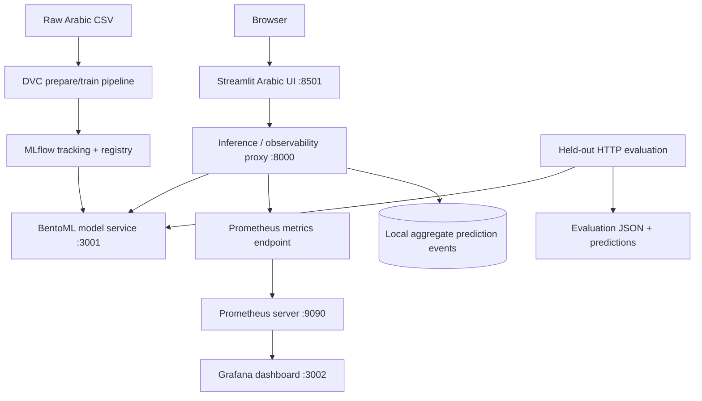

# Arabic Sentiment MLOps — End-to-End Project Report

> **Project snapshot:** 18 October 2026<br>
> **Track:** Deep Learning / Arabic Sentiment Analysis (Track A in *The MLOps Practitioner — Mini Projects & Final Project Handbook*)<br>
> **Repository:** [`MoohamedMahmoud/arabic-sentiment-mlops`](https://github.com/MoohamedMahmoud/arabic-sentiment-mlops)<br>
> **Current development branch:** `module-3-serving-release`<br>
> **Latest confirmed pushed commit:** `3796ec7` — `feat: finalize Arabic sentiment serving`

<div align="center">

**Arabic-language review sentiment · AraBERT · Reproducible MLOps pipeline**


</div>

**Document purpose.** This file is the consolidated project story, not just installation instructions. It records why the dataset was selected, what the data notebook discovered, how notebook work became package/DVC/MLflow code, which AraBERT trials were compared, how serving and observability were assembled, what every evaluation actually proved, and which handbook items still require evidence.

> **Evidence rule:** the offline test metrics, small HTTP smoke test, service-health checks, and failed full HTTP evaluation are different experiments. They are reported separately below. A local service that starts is not automatically a model that passes quality or load testing.

### Contents

- [1. Executive summary](#1-executive-summary)
- [2. Development environment and setup](#2-development-environment-and-project-setup)
- [3. Business problem and scope](#3-business-problem-and-project-scope)
- [4. Dataset choice, provenance, and papers](#4-dataset-choice-provenance-and-research-context)
- [5. Data understanding and cleaning](#5-data-understanding-and-cleaning-decisions)
- [6. AraBERT trials and offline evaluation](#6-model-training-and-offline-evaluation)
- [7. Package and tests](#7-python-package-repository-structure-and-automated-tests)
- [8. DVC and MLflow](#8-dvc-mlflow-tracking-and-model-registry)
- [9. BentoML packaging and Docker](#9-serving-packaging-mlflow--bentoml--docker)
- [10. UI, proxy, Prometheus, and Grafana](#10-ui-inference-proxy-prometheus-and-grafana)
- [11. Served predictions and evaluation](#11-api-prediction-checks-and-served-model-evaluation)
- [12. GitHub and release workflow](#12-git-ci-and-release-workflow)
- [13. Handbook checklist](#13-handbook-requirement-by-requirement-status)
- [14. Runbook](#14-reproducible-local-runbook)
- [15. Remaining work and conclusions](#15-known-gaps-and-prioritized-next-steps)
- [References](#references)

---

## 1. Executive summary

The project develops a three-class Arabic sentiment classifier and wraps it in an MLOps workflow. The input is Arabic review text; the output is one of `NEGATIVE`, `NEUTRAL`, or `POSITIVE`, with a confidence score. The selected model family is AraBERT, fine-tuned with PyTorch and Hugging Face Transformers.

The project evolved from data understanding and model training into package-based Python code, DVC data preparation, MLflow tracking and model registration, BentoML serving, a Streamlit interface, a FastAPI inference/observability proxy, Prometheus metrics, and a provisioned Grafana dashboard.

### Current state at a glance

| Area | Verified outcome | Current limitation |
|---|---|---|
| Dataset preparation | The original GitHub-hosted corpus was supplied as `alldata.csv` plus `train.csv`, `dev.csv`, and `test.csv`; the all-data file was audited and new leakage-checked splits were prepared | The exact upstream GitHub repository URL has not been recovered from retained chat/files; 88,738 cleaned audit rows vs 88,737 prepared split rows needs reconciliation |
| Offline AraBERT model | Held-out test accuracy **0.8757**, macro-F1 **0.8681** in the saved tuning report | These offline results must not be presented as the measured performance of the currently served MLflow version without verifying artifact identity and preprocessing parity |
| Python quality | `ruff` checks passed; compile check passed; **29 pytest tests passed** | One non-blocking Starlette/httpx deprecation warning was reported |
| DVC and MLflow | DVC pipeline/configuration exists; MLflow tracking/registry used; registered model `ArabicSentiment` version `2` | A fully reproducible clean-clone run still depends on data/remote credentials and the local model artifacts |
| BentoML / Docker | Bento built and containerized as `arabic-sentiment-service:vetbwwgkosur4aav`; `/readyz` returned HTTP 200; metadata returned model version 2, batch size 8, latency 2000 ms | Full 8,874-row served-model evaluation still fails intermittently with HTTP 503 overload responses |
| UI and service endpoints | API proxy, Streamlit, Prometheus, Grafana, and MLflow endpoint checks returned HTTP 200 | An HTTP 200 homepage/health check is not the same as a complete UI interaction or stable sustained-load test |
| Served-model metrics | A 32-row smoke evaluation completed | Smoke metrics are not a full evaluation; quality gate intentionally rejects this artifact as incomplete |
| GitHub | Branch `module-3-serving-release` pushed at commit `3796ec7` | This is not evidence of a merged PR to `main`; `ui/`, a change to `model.py`, and the comprehensive root README were not included in the staged commit shown in the terminal history |
| Handbook completion | Important Module 1–3 and basic monitoring building blocks exist | Load-test acceptance, canary evidence, optimization journey (Module 4), complete Module 5 monitoring acceptance, CI result, PR merge, and peer review are not yet evidenced |

**Central conclusion:** an offline-capable classifier and a locally running application stack have been built. The project has not yet demonstrated successful full-set inference under sustained evaluation, and the entire five-module handbook is not complete based on the recorded artifacts. The remaining gaps are stated explicitly at the end of this report.

---

## 2. Development environment and project setup

The work was carried out primarily in Windows PowerShell in one Git repository, `arabic-sentiment-mlops`, under the MLOps MENA final-project directory. The repository was cloned from GitHub, so a second `git init` and a manually added `origin` were not needed after cloning. The workflow was to use the existing `main` branch as the base, create a feature branch for the next module, and push/submit changes through a pull request rather than create a separate repository for every stage.

Recorded development environment details:

| Component | Recorded setup |
|---|---|
| OS / shell | Windows, PowerShell |
| Python | 3.12.7, pinned to the Python 3.12 series |
| Package/environment manager | `uv` 0.12.5 |
| Git | 2.39.1.windows.1 |
| Local virtual environment | `.venv` inside the repository |
| GPU reported by `nvidia-smi` | NVIDIA GeForce RTX 3060, 6 GB VRAM |
| Driver-reported CUDA compatibility | CUDA 13.2 (this is what the NVIDIA driver reported; it is not by itself proof that every container uses the GPU) |

The package/environment setup used `uv init --package`, `uv python pin 3.12`, and `uv venv`; `uv.lock` records dependency resolution. Project dependencies include the PyTorch/Transformers/AraBERT training stack, MLflow, DVC, BentoML, FastAPI, Streamlit, and monitoring/testing tools. The direct `pydantic-settings` dependency was added during configuration work. The host GPU made local GPU fine-tuning possible; **do not claim the Docker serving container uses the GPU** unless GPU passthrough and runtime utilization are explicitly configured and measured.

### Conclusion of setup

The work moved into a reproducible package-based project rather than remaining a notebook-only experiment. Windows-specific shell commands and local data/model artifacts remain relevant to reproduction, so commands in this document are PowerShell examples.

---

## 3. Business problem and project scope

### 3.1 Problem statement

A review platform needs to summarize large volumes of Arabic user feedback into positive, neutral, and negative sentiment. A deployed classifier can assist review analysis, product feedback summaries, and prioritization of negative experiences. It must handle Arabic spelling variation, informal language, short ambiguous messages, negation, and mixed sentiment.

### 3.2 Prediction contract

- **Input:** Arabic review text (single review or a batch, depending on endpoint).
- **Output classes:** `NEGATIVE`, `NEUTRAL`, `POSITIVE`.
- **Output fields:** predicted label and confidence; the proxy and service also expose model metadata and health information.
- **Model family:** AraBERT v0.2 sequence classifier, with the implementation and model artifacts managed in the project.
- **Serving path:** Streamlit browser UI → inference proxy → BentoML model service.

This is a three-class **text classification** system, not a generative LLM or a RAG application.

---

## 4. Dataset choice, provenance, and research context

This section deliberately separates the dataset that was discussed during selection from the data that the project actually processed.

### 4.1 Candidate discussed: the KAUST Arabic Sentiment Analysis 2021 competition

One candidate considered during dataset selection was the [Arabic Sentiment Analysis 2021 Competition at KAUST](https://www.kaggle.com/c/arabic-sentiment-analysis-2021-kaust/data). Its overview paper, [*Overview of the Arabic Sentiment Analysis 2021 Competition at KAUST*](https://arxiv.org/abs/2109.14456), describes a three-way sentiment task over **tweets**, not app or product reviews. The competition paper describes 55,000 training tweets, a 20,000-tweet public validation/leaderboard split (`TEST1`), and another 20,000-tweet private test split (`TEST2`). The paper describes the release as a 100K dataset in its abstract, while its split table totals 95,000 examples; when citing the paper's split sizes, the explicit `55K + 20K + 20K` split counts are the most precise description.

The paper also reports **Macro-F1** as the official ranking metric and describes a two-phase competition: public leaderboard evaluation on `TEST1`, then code submitted by top-ranked teams evaluated on the hidden `TEST2`. It notes that top teams commonly used pretrained Arabic transformer models, particularly MARBERT, with preprocessing such as removing URLs, hashtags, user identifiers, and repeated characters. Our project differs in model family (AraBERT v0.2), data domain (reviews, not tweets), and evaluation process. We took the methodological lesson—keep training, validation and final test separate, use a metric that reflects every class, and don't tune against the final test set—not the paper's data or numeric leaderboard results.

**Important distinction:** the `data/raw/alldata.csv` used in this project does **not** look like the KAUST tweet corpus. Its first records are app-style Arabic comments about children's learning applications, with labels such as `NEUTRAL` and `POSITIVE`. Therefore, the KAUST competition was a candidate/reference during research, not a verified source attribution for the corpus ultimately used.

For the final project, one dataset was the more defensible starting point than merging two unrelated corpora: tweets and application reviews differ in genre, length, vocabulary, label source, and likely annotation process. Combining them without a carefully designed domain-generalization experiment could make the results hard to interpret. The final local pipeline therefore uses one locally supplied review corpus; KAUST remains a methodology reference only.

| Dimension | KAUST 2021 paper/competition | This project |
|---|---|
| Text domain | Arabic tweets | App-style Arabic reviews in the local CSV |
| Labels | Positive / Negative / Neutral | `POSITIVE` / `NEGATIVE` / `NEUTRAL` |
| Split strategy described in the source | Public train and validation sets with a separate private leaderboard test set | Audit the supplied files, remove missing/conflicting/duplicate records, then prepare separate train/validation/test splits |
| Dataset used for the reported AraBERT score below? | **No evidence that it was used** | Local `alldata.csv` |
| Score comparability | Not comparable without the same corpus and evaluation protocol | Report metrics against this project's own held-out split |

### 4.2 Actual local data artifact

The raw file inspected in this project is `data/raw/alldata.csv`. It is a headerless UTF-8 CSV with two columns interpreted as `text` and `label`.

The raw file's measured properties are:

| Check | Result |
|---|---:|
| Raw rows | **110,760** |
| Columns | 2 (`text`, `label`) |
| Missing text values | 0 |
| Blank text values | 0 |
| Missing labels | 1 |
| `NEGATIVE` labels | 46,827 |
| `NEUTRAL` labels | 32,129 |
| `POSITIVE` labels | 31,803 |
| Exact-text duplicate rows beyond the first copy | 21,888 |
| Unique exact text values among labeled rows | 88,871 |

The one unlabeled record is not valid supervised training data. The label distribution is also not balanced: the negative class is larger than either neutral or positive.

### 4.3 Where the files came from, and what remains unverified

The actual workflow began with a **GitHub-hosted repository** that contained four CSV artifacts: `alldata.csv`, `train.csv`, `dev.csv`, and `test.csv`. We downloaded those files; `alldata.csv` was the raw/unprocessed input for **our** pipeline, meaning it had not yet gone through the cleaning, duplicate-conflict policy, stratified resplitting, and DVC pipeline we implemented. The presence of pre-existing `train/dev/test` files did not mean that those splits were automatically safe to use.

The precise GitHub repository URL/name is **not present in the retained chat/files I could retrieve**, and a public search did not identify a repo that could be matched confidently to this exact 110,760-row file. I have therefore not invented a repository link or cited a lookalike as the source. For a release-quality citation, this is the one source detail that still needs recovery from browser history, the original download command, shell history, or the source repository name.

A related, publicly documented corpus surfaced during source checking: [Arabic 100K Reviews by Abed Khooli (Kaggle)](https://www.kaggle.com/datasets/abedkhooli/arabic-100k-reviews). A public Hugging Face copy describes 99,999 examples with numeric sentiment labels. This is **a candidate/reference only, not a confirmed identity** for our file: the local raw file has 110,760 rows and already uses string labels. Do not replace the missing original GitHub citation with this Kaggle link unless the original mirror can be shown to derive from that exact dataset.

Another related paper is [GLARE: Google Apps Arabic Reviews Dataset](https://arxiv.org/abs/2412.15259). GLARE documents a large Saudi Google Play review collection, but its scale and released dataset structure differ greatly from our small labeled corpus. It is relevant background for Arabic app-review NLP, not a verified source of `alldata.csv`.

**Release note:** dataset provenance is a real reproducibility requirement. Until the exact GitHub URL, upstream license, and any original dataset/paper citation are recovered, document the verified local processing lineage without claiming an unverified upstream identity.

### 4.4 Model research reference: AraBERT

The model choice is informed by [Antoun, Baly, and Hajj, *AraBERT: Transformer-based Model for Arabic Language Understanding* (2020)](https://arxiv.org/abs/2003.00104) and the [official AraBERT repository](https://github.com/aub-mind/arabert). AraBERT is a BERT-family model pretrained for Arabic language understanding. Fine-tuning its pretrained representations is more appropriate for this task than training a transformer from scratch on the local labeled data.

The training notebook uses the checkpoint name `aubmindlab/bert-base-arabertv02`, an AraBERT v0.2 sequence-classification setup, and AraBERT preprocessing plus the Hugging Face tokenizer. The pretraining checkpoint's original language-model head is replaced with a newly initialized classification head; Transformers reported missing classifier weights and extra pretraining-head weights at initialization. This is expected when adapting a pretrained language model to a different downstream task, and the new classification head must be learned during fine-tuning.

**Dataset paper vs. model paper:** the KAUST paper describes a different tweet dataset; the AraBERT paper supports the model-family choice. Neither one is currently a verified citation for the provenance of `alldata.csv`.

---

## 5. Data understanding and cleaning decisions

The first data notebook was built as an audit, not as a training notebook. Its purpose was to test assumptions before cleaning and to preserve the original input unchanged.

### 5.1 Checks performed

The audit notebook inspects:

1. File shape, column interpretation, types, and sample records.
2. Missing text, empty text, and missing labels.
3. Label vocabulary and class distribution.
4. Examples sampled from each class to check whether labels appear semantically plausible.
5. Exact duplicate strings.
6. Canonical duplicates, where whitespace is normalized and Arabic diacritics/tatweel are removed **for duplicate detection**.
7. Canonical text groups whose rows have conflicting sentiment labels.
8. Text character/word lengths and rough sequence-truncation pressure.
9. Rating-like leading words (for example, “ممتاز”, “رائع”, “جيد”, and “ضعيف”) to investigate possible label shortcuts.
10. Whether supplied train/dev/test splits overlap with one another and with the all-data artifact.

The audit uses `RANDOM_STATE = 42` for repeatable sampling. Raw input files are not overwritten by the audit.

### 5.2 Why exact and canonical duplicates both matter

Exact duplicate detection catches repeated strings. Canonical duplicate detection additionally catches some surface-form differences caused by whitespace, Arabic diacritics, or tatweel. Repeated review text can make a test score too optimistic if identical or almost-identical entries appear in both training and evaluation. The same canonical text with multiple sentiment labels is also a data-quality problem: it can represent annotation noise, ambiguous wording, or a conflict that needs special handling.

The audit measured:

- **21,888** exact duplicate rows beyond the first occurrence among labeled records, leaving 88,871 unique exact strings.
- **22,002** repeated rows when using the stronger canonical key; **88,757** unique canonical keys before removing conflicting-label groups.
- **19** canonical text keys with conflicting sentiment labels.
- **108** rows belonging to those conflicting canonical-text groups.

### 5.3 Conservative cleaning preview

The audit's recommended policy was:

1. Leave the raw file unchanged.
2. Drop rows with a missing label.
3. Build a canonical-text key for audit and leakage prevention.
4. Exclude every row belonging to a conflicting canonical-text group rather than arbitrarily selecting one of its different labels.
5. Keep one occurrence of each remaining canonical text.
6. Create new stratified train/validation/test splits.
7. Verify that split boundaries do not share duplicate review text.

The notebook reported this progression:

| Stage | Rows |
|---|---:|
| Raw input | 110,760 |
| After excluding missing labels | 110,759 |
| After excluding conflicting canonical-text groups | 110,651 |
| After canonical deduplication (audit preview) | **88,738** |
| Retained from labeled rows | **80.12%** |

Canonical normalization here is a duplicate key, not a promise that the actual model input is fully normalized by all the same transformations. The final model preprocessing uses the AraBERT preprocessor and tokenizer; these are model-input steps and should remain consistent between training and inference.


### 5.3.1 Length analysis and rating-headline / shortcut checks

The notebook measured text length before selecting a model token limit. The cleaned audit preview had a long-tailed length distribution:

| Statistic | Character count | Whitespace-separated words |
|---|---:|---:|
| Median (P50) | 70 | 13 |
| P90 | 309 | 58 |
| P95 | 556 | 105 |
| P99 | 1,543 | 295 |
| Maximum | 7,858 | 1,485 |

Word count is only a rough proxy for subword tokens. In the AraBERT baseline notebook, the **actual tokenizer** gave a P95 length of **132 tokens**. Rounding upward to the next multiple of 32 led to a selected `max_length=160`; the reported estimated truncation rate at that limit was **3.88%**. This is the data-driven reason recorded for the training length, not an arbitrary default. The serving metadata currently reports length 256, so this remains a model-serving configuration parity item rather than proof that the training choice was 256.

The audit also investigated whether the corpus contains sentiment-bearing words at the start of reviews that might behave like rating headings. **18,458 rows (16.67% of labeled rows)** began with one of the tested phrases (`مخيب للأمل`, `مخيب`, `ضعيف`, `مقبول`, `مرضي`, `جيد`, `رائع`, `ممتاز`, `استثنائي`). Among these, the class counts were 7,744 negative, 5,900 neutral, and 4,814 positive. These phrases can be genuine user language as well as a possible shortcut signal, so the notebook measured and sampled them rather than blindly stripping them.

The packaged `prepare.py` cleaning policy does **not** apply a global headline-stripping rule. It preserves the review text except for trimming outer whitespace; its deterministic cleaning focuses on missing/unknown labels, conflicting canonical groups, and duplicate canonical texts. Shortcut removal remains an experiment that would require a controlled comparison on the same held-out evaluation set before adopting it.

### 5.4 Why the originally supplied splits were not trusted unchanged

The audit also inspected the original files that arrived with the GitHub-hosted data: `train.csv`, `dev.csv`, and `test.csv`. The notebook reported these sizes and cross-split canonical-key overlaps:

| Original supplied file | Rows | Audit finding |
|---|---:|---|
| `train.csv` | 87,334 | Shared 7,918 canonical text keys with `dev`; 1,195 with `test` |
| `dev.csv` | 9,991 | Shared 7,918 canonical text keys with `train`; 3 with `test`; three train/dev overlapping texts had conflicting labels |
| `test.csv` | 10,015 | Shared 1,195 canonical text keys with `train`; 3 with `dev` |

The notebook also found records in each supplied split whose canonical keys were absent from `alldata.csv` (56 train, 89 dev, and 8 test keys). This points to duplicated content and a possible corpus/version mismatch between the all-data file and the provided split files. These original file counts are audit observations, not the final train/validation/test counts used for the reported offline results.

Because split overlap can leak repeated text across evaluation boundaries, the project did not blindly accept the original split files as the final model evaluation setup. Instead, we treated `alldata.csv` as the raw input for our reproducible preparation process, investigated conflicting labels and duplicate texts, and created new stratified splits. The final training notebook loads the prepared Parquet files and explicitly checks that text overlap between train, validation, and test is zero. Its recorded counts are:

| Prepared split | Rows | Percentage of 88,737 |
|---|---:|---:|
| Train | 70,989 | 80% |
| Validation | 8,874 | 10% |
| Test | 8,874 | 10% |
| **Total** | **88,737** | **100%** |

The notebook's exact-text train/validation/test overlap check passed with zero pairwise overlap.

**One reproducibility discrepancy remains:** the cleaning audit preview produced 88,738 rows, while the prepared model splits total 88,737 rows. Their class counts differ by one negative example. This is small but should be reconciled in the preparation/data-card workflow before treating the pipeline as completely frozen.

### 5.5 Prepared label distribution

| Split | `NEGATIVE` | `NEUTRAL` | `POSITIVE` | Total |
|---|---:|---:|---:|---:|
| Train | 33,107 | 20,215 | 17,667 | 70,989 |
| Validation | 4,138 | 2,527 | 2,209 | 8,874 |
| Test | 4,139 | 2,527 | 2,208 | 8,874 |
| **Total** | **41,384** | **25,269** | **22,084** | **88,737** |

The prepared dataset remains class-imbalanced, especially with more negative than positive examples. Accuracy alone would hide some class-specific weaknesses, so macro-F1 and per-class F1 are reported as well.

### 5.6 Conclusion of the data stage

The original file was not ready for a trustworthy experiment simply because it had three labels and train/dev/test files already existed. It contained a missing label, substantial duplicate text, conflicting labels for some canonicalized texts, and supplied splits with large overlap. The main conclusion was to **audit first, keep raw data immutable, and recreate the split boundaries from the all-data file rather than assume that inherited CSV splits are leakage-free**. Rebuilding the splits after cleaning and explicitly checking overlap made model evaluation more defensible. Remaining actions are recovering the exact upstream GitHub URL/license and reconciling the one-row count discrepancy.

---

## 6. Model training and offline evaluation

### 6.1 Training methodology

The baseline notebook, `02-arabert-baseline.ipynb`, follows this flow:

`prepared train/validation/test → AraBERT preprocessing → tokenizer → GPU fine-tuning → validation model selection → final held-out test evaluation → saved model/report`

Key methods and settings recorded in the notebook/logs:

- Pretrained checkpoint: `aubmindlab/bert-base-arabertv02`.
- Frameworks: PyTorch, Hugging Face Transformers, Datasets, scikit-learn, and AraBERT preprocessing.
- Seed: `42` for Python, NumPy, and the training framework.
- Evaluation metrics: accuracy, macro-F1, per-class precision/recall/F1, confusion matrix, and loss.
- Selected run: learning rate `2e-5`, 3 epochs, maximum sequence length `160`.
- Recorded training configuration from the project's config: train batch size `4`, evaluation batch size `8`, gradient accumulation `4`, weight decay `0.01`, random seed `42`.
- Training split: 70,989 examples.
- Validation split: 8,874 examples.
- Held-out test split: 8,874 examples.
- Hyperparameter selection: compare learning rate, epoch count, and maximum sequence length; choose the checkpoint using validation Macro-F1 rather than choosing settings from test metrics.

### 6.2 Tuning trials captured in the training log

| Trial | Learning rate | Epochs | `max_length` | Validation accuracy | Validation macro-F1 | Validation loss | Training time |
|---|---:|---:|---:|---:|---:|---:|---:|
| Previously saved baseline | 2e-5 | 2 | 160 | 0.873112 | 0.866439 | 0.344909 | Not recorded |
| `trial_01_lr_1e-5` | 1e-5 | 2 | 160 | 0.865450 | 0.857881 | 0.351227 | 70.5 min |
| `trial_02_lr_3e-5` | 3e-5 | 2 | 160 | 0.875704 | 0.868894 | 0.358200 | 57.2 min |
| `trial_03_epochs_3` | 2e-5 | 3 | 160 | **0.876944** | **0.869857** | 0.435325 | 92.3 min |
| `trial_04_max_length_256` | 2e-5 | 2 | 256 | 0.874352 | 0.867409 | **0.336041** | 57.1 min |

**Comparison against the saved baseline:**

| Trial | Δ validation accuracy | Δ validation macro-F1 | Interpretation |
|---|---:|---:|---|
| `trial_01_lr_1e-5` | -0.007662 | -0.008558 | Weaker accuracy and Macro-F1 under the recorded two-epoch budget; not selected |
| `trial_02_lr_3e-5` | +0.002592 | +0.002455 | Stronger and faster two-epoch option; close second on Macro-F1 |
| `trial_03_epochs_3` | **+0.003832** | **+0.003418** | **Selected:** highest validation accuracy and Macro-F1 in the recorded sweep |
| `trial_04_max_length_256` | +0.001240 | +0.000970 | Lowest validation loss, but lower Macro-F1 than trials 2 and 3 |

`trial_03_epochs_3` gained **0.003418 Macro-F1** (about **0.34 percentage points**) and **0.003832 accuracy** (about **0.38 percentage points**) over the saved baseline, at a recorded training time of 92.3 minutes. Compared with `trial_02_lr_3e-5`, the Macro-F1 gain was only 0.000963 (about 0.10 percentage points) for roughly 35.2 additional minutes. Thus, trial 2 is a reasonable lower-cost near-best alternative, though trial 3 won by the project's chosen validation selection metric.

The `max_length=256` trial produced the lowest validation loss but did not achieve the strongest accuracy or Macro-F1. This is why selection used validation Macro-F1 rather than loss alone. The recorded sweep does **not** prove that longer inputs are universally worse; it only shows that `max_length=256` did not win in these particular settings. Trial 3's higher loss despite the strongest Macro-F1 is also a reason to inspect calibration and error patterns rather than assume one metric tells the whole story.

#### How this compares with the paper/split decision

The KAUST competition paper was considered as a benchmark reference, but it describes a tweet dataset and its own public development/private test setup, not our local review CSV. We did **not** import its split sizes or compare scores directly with its leaderboard. For this project we used the audited `alldata.csv`, made new leak-checked 80/10/10 splits, selected settings on validation Macro-F1, and used the 8,874-row test split only for the final offline report. This is the part of the methodology we adopted: preserve a held-out evaluation set and do not tune against it—not claim a paper-to-paper numerical comparison across different data.

### 6.3 Held-out test results for the selected offline checkpoint

The saved tuning output records the following metrics on the 8,874-row test split:

| Metric | Value |
|---|---:|
| Test accuracy | **0.8757** |
| Test macro-F1 | **0.8681** |
| Test loss | **0.4389** |
| Weighted F1 | 0.8761 |

Per-class results:

| Class | Precision | Recall | F1 | Support |
|---|---:|---:|---:|---:|
| `NEGATIVE` | 0.9223 | 0.9007 | **0.9114** | 4,139 |
| `NEUTRAL` | 0.8163 | 0.8421 | **0.8290** | 2,527 |
| `POSITIVE` | 0.8607 | 0.8673 | **0.8640** | 2,208 |
| **Macro average** | 0.8664 | 0.8700 | **0.8681** | 8,874 |
| **Weighted average** | 0.8768 | 0.8757 | 0.8761 | 8,874 |

Confusion matrix (rows = true label, columns = predicted label):

| True \ Predicted | `NEGATIVE` | `NEUTRAL` | `POSITIVE` |
|---|---:|---:|---:|
| `NEGATIVE` | 3,728 | 292 | 119 |
| `NEUTRAL` | 208 | 2,128 | 191 |
| `POSITIVE` | 106 | 187 | 1,915 |

### 6.4 Interpretation and conclusion

- **Negative sentiment was the strongest class**, with F1 0.9114.
- **Neutral was the weakest class**, with F1 0.8290. This is an important focus for error analysis because short or mixed Arabic comments can be ambiguous, and the class boundary between neutral and polar sentiment can be subtle.
- The confusion matrix shows neutral examples being predicted as negative or positive, and negative/positive examples sometimes moving into neutral.
- Macro-F1 (0.8681) is useful alongside accuracy because it gives the three classes equal weight rather than letting the largest class dominate.
- These results show that the selected offline checkpoint learned a useful classifier. They do not, by themselves, prove parity with the MLflow model currently served by BentoML.

### 6.5 Model/preprocessing parity caveat

The selected offline tuning configuration used `max_length=160`. The current BentoML metadata reports `max_length=256` for registered MLflow model version 2. That mismatch means the deployed artifact and tuning report must be checked for identity and preprocessing parity before the offline metrics are attributed to the service. It may be an artifact/version/configuration difference; current evidence does not justify assuming that the mismatch has no effect.

A previous exported baseline notebook also contains an earlier result around accuracy 0.8730 and macro-F1 0.8663. The newer tuning log contains 0.8757 / 0.8681. The saved tuning report is used above as the principal offline result, but only one canonical training report and artifact hash should be treated as the release record.

---

## 7. Python package, repository structure, and automated tests

The project was moved from experimentation toward a reusable package using a `src/` layout, `pyproject.toml`, `uv.lock`, and a Python 3.12 environment. The work was done in Windows PowerShell with `uv` managing dependencies and project execution.

Relevant project conventions:

- `src/arabic_sentiment_mlops/` contains reusable application/model code rather than placing all logic in notebooks.
- A model class loads tokenizer/model assets and centralizes prediction behavior.
- Type hints and explicit label mappings (`NEGATIVE=0`, `NEUTRAL=1`, `POSITIVE=2`) make the inference contract clearer.
- `predict.py` adapts the registered MLflow model for the project-facing predictor interface.
- `mlflow_model.py` defines the MLflow pyfunc wrapper and routes DataFrame/Series inputs to batch prediction.
- The batch prediction path tokenizes a list of texts with padding, performs a single model forward pass under `torch.inference_mode()`, computes probabilities, and returns per-text labels/confidence.
- `pydantic-settings` was added as a direct dependency for configuration handling.
- Raw data, `.env` credentials, virtual environments, model caches, and generated files should not be committed indiscriminately.

### 7.1 Code checks completed

The following commands were run successfully during the most recent code-quality pass:

```powershell
uv run ruff format src/arabic_sentiment_mlops/predict.py src/arabic_sentiment_mlops/model.py
uv run ruff check src/arabic_sentiment_mlops
uv run python -m compileall src/arabic_sentiment_mlops
uv run pytest -q
```

Recorded outputs:

- Ruff formatting: 2 files left unchanged.
- Ruff linting: `All checks passed!`
- `compileall`: completed successfully.
- Pytest: **29 passed, 1 warning, in 11.30 seconds**.
- Warning: `StarletteDeprecationWarning` indicates use of `httpx` with `starlette.testclient` is deprecated and suggests `httpx2`. It did not fail the test suite; it remains a dependency/test cleanup item.

These checks establish useful local code quality. They do not imply that load testing or the production quality gate passed.


### 7.2 Component map: what each area owns

| Path / component | Responsibility | Evidence and boundaries |
|---|---|---|
| `src/arabic_sentiment_mlops/` | Reusable data preparation, preprocessing, model class, predictor and MLflow pyfunc wrapper | Source code used by training/serving; the local quality pass covered the package |
| `data/raw/alldata.csv` | Original GitHub-sourced input artifact | Raw data is local/DVC-managed and must not be added to Git as a normal source file |
| `data/processed/*.parquet` | Prepared train/validation/test splits | Generated by the DVC preparation stage; the current 88,737-row total needs reconciliation with the 88,738-row audit preview |
| `dvc.yaml` | Data preparation and training pipeline graph | `uv run dvc status` and `uv run dvc repro` are the normal inspection/reproduction commands |
| `serving/service.py`, `serving/import_model.py`, `bentofile.yaml` | Load the registered MLflow model into BentoML and define the service/container build | Current container image is `arabic-sentiment-service:vetbwwgkosur4aav` |
| `ui/` | Streamlit user experience for entering Arabic text and displaying label/confidence | The folder existed locally as untracked at the latest recorded Git status; include it deliberately in the final PR |
| `monitoring/api_proxy.py` | Proxy for prediction/metadata/health plus aggregate telemetry | Upstream metadata call was corrected to use POST; proxy responds on port 8000 |
| `monitoring/prometheus.yml`, `monitoring/grafana/`, `monitoring/alerts.yml` | Prometheus scrape configuration, provisioned Grafana dashboard/datasource, and alert definitions | Files exist; a file existing does not prove every alert is routed or tested end-to-end |
| `docker/docker-compose.yml` | MLflow + PostgreSQL + RustFS infrastructure | Separate Compose project; keep it separate from the UI/observability stack |
| `docker/docker-compose.observability.yml` | UI + inference proxy + Prometheus + Grafana | Does not require rebuilding when only the Bento model image changes |
| `scripts/evaluate_served_model.py`, `scripts/quality_gate.py` | Evaluate real HTTP predictions and enforce minimum quality thresholds | Smoke run passed; complete held-out served evaluation remains incomplete |
| `loadtest/locustfile.py`, `reports/locust/` | Synthetic load and performance evidence | Script exists, but final successful load report was not verified in the retained output |
| `docs/`, `reports/` | Runbook, integration map, evaluation output and supporting evidence | Keep smoke-test artifacts labelled as smoke tests; do not replace with partial results and call them final |
| `.github/workflows/ci.yml` | GitHub Actions CI definition | Local test pass is confirmed; a green remote Actions run is not yet confirmed |

The last confirmed feature-branch commit (`3796ec7`) did **not** include every current working-copy file: `ui/` was untracked, `src/arabic_sentiment_mlops/model.py` was modified but unstaged, and the root README was not updated in that commit. The final PR should include the intended version of those files after reviewing them, while excluding local Word documents, `.bak` files, secrets, virtual environments, and raw data.

---

## 8. DVC, MLflow tracking, and model registry

### 8.1 DVC data and pipeline versioning

The project uses DVC to describe data preparation and training stages in `dvc.yaml`. The preparation stage is recorded as:

```powershell
uv run python -m arabic_sentiment_mlops.prepare --input data/raw/alldata.csv --output data/processed --seed 42
```

Its documented outputs include Parquet train, validation, and test artifacts plus a `data_card.json` provenance artifact. The data card records the raw-file SHA-256, preparation seed, allowed sentiment labels, cleaning counts, split row counts, and per-split label distributions. The training stage is also described in the DVC pipeline, with source code and prepared data as dependencies. DVC is intended to make the data/model workflow explicit and reproducible, rather than relying on undocumented notebook state.

Useful commands:

```powershell
uv run dvc status
uv run dvc repro
```

A clean clone can reproduce the workflow only if its raw data and DVC remote artifacts are actually available and the necessary remote credentials are configured. Do not commit `.env`, object-store keys, or other secrets to make a local run work.

### 8.2 MLflow experiments and registry

MLflow is used to record experiments, store model artifacts, and register the selected model. The registered model observed in the live service metadata is:

- Registered model: `ArabicSentiment`
- Model version: `2`
- Bento's bundled model tag: `arabic_sentiment_v2:ui5zcfgkc2qxoaav`

The local infrastructure uses PostgreSQL as the MLflow backend store and RustFS as an S3-compatible artifact store. The MLflow tracking UI is exposed on `127.0.0.1:5000`; RustFS is exposed locally on ports `9000–9001`; PostgreSQL uses internal port `5432` in the Compose network.

### 8.3 Infrastructure startup

The MLflow infrastructure is a separate Compose project from the serving/observability stack:

```powershell
docker compose --env-file .env -f docker/docker-compose.yml --project-directory . up -d
```

The runtime checks recorded MLflow and PostgreSQL as healthy, and RustFS as running. The `create-mlflow-bucket` initialization container exits after its one-time task, which is expected for a setup job.

### 8.4 Conclusion of tracking/versioning stage

Experiment tracking and registry registration exist, and version 2 is being loaded into BentoML. The remaining reproducibility item is to connect a single immutable model artifact/checkpoint hash to the offline evaluation, the MLflow registry version, the Bento bundle, the served evaluation report, and the release tag. Until that chain is explicit, offline and online scores should be reported separately.

---

## 9. Serving packaging: MLflow → BentoML → Docker

### 9.1 A real packaging failure and its fix

An earlier BentoML container failed during startup with `ModuleNotFoundError: No module named 'arabic_sentiment_mlops'`. The serialized MLflow pyfunc model imports project Python code during load, so installing only the public runtime packages was insufficient: the application package also needed to be available inside the Bento container.

The packaging was corrected by building the local project wheel and adding it to the Bento build:

```powershell
uv build --wheel
Copy-Item .\dist\arabic_sentiment_mlops-0.1.0-py3-none-any.whl `
          .\wheels\arabic_sentiment_mlops-0.1.0-py3-none-any.whl -Force
uv run bentoml build
```

The observed SHA-256 for the copied wheel was:

```text
ED3D0F3B8D8E2A7F003CC604AF399A45DA33E0C815C53ECEFB2A8CD6EAC8027B
```

BentoML then built:

```text
arabic-sentiment-service:vetbwwgkosur4aav
```

Containerization completed successfully with:

```powershell
uv run bentoml containerize arabic-sentiment-service:vetbwwgkosur4aav
```

The `wheels/` file may be ignored by Git; on a clean checkout, build the wheel and copy it into the expected `wheels/` path before invoking `bentoml build`. A small build script would be a better long-term reproducibility improvement than relying on someone remembering these manual steps.

### 9.2 Current serving configuration

The latest live container is named `arabic-sentiment-bento` and uses image `arabic-sentiment-service:vetbwwgkosur4aav`. It exposes container port `3000` on host port `3001`. The preceding container was renamed to `arabic-sentiment-bento-previous` and stopped, rather than deleted, so the older image/container remains available as a rollback option.

The new service returned HTTP 200 at `/readyz` and returned the following metadata through `POST /metadata`:

| Setting | Reported value |
|---|---|
| Service | `arabic-sentiment-service` |
| MLflow registered model | `ArabicSentiment` |
| MLflow model version | `2` |
| Bundled Bento model tag | `arabic_sentiment_v2:ui5zcfgkc2qxoaav` |
| Maximum sequence length in service metadata | `256` |
| Adaptive batch maximum size | `8` |
| Adaptive batch latency setting | `2000 ms` |

The BentoML service uses a batchable prediction API, loads the MLflow model at service initialization, validates/strips incoming texts, and returns labels with confidence values. Its exact behavior is implemented in `serving/service.py`.

### 9.3 Why adaptive batching was changed

An earlier service configuration reported a maximum batching latency of `100 ms`; the latest build reports `2000 ms` with `max_batch_size=8`. Vectorized inference was also introduced in the model class to avoid implementing a batch as a loop of one-row forward passes. The intent was to reduce repeated model-call overhead and improve the serving behavior under a sustained evaluation.

This was a reasonable optimization hypothesis, but only measurement can establish whether it helped. The full test-set run advanced farther in the newer configuration but still encountered overload, so the serving optimization cannot yet be called successful under load.

---

## 10. UI, inference proxy, Prometheus, and Grafana

### 10.1 Service architecture



This separation was intentional. Streamlit provides the user-facing application; the proxy mediates requests and captures serving telemetry; BentoML serves the registered model; Prometheus scrapes metrics; Grafana presents a version-controlled dashboard. MLflow/PostgreSQL/RustFS make up a separate experiment/artifact infrastructure stack.

### 10.2 Local endpoints

| Component | Address | Purpose |
|---|---|---|
| Streamlit Arabic sentiment UI | `http://127.0.0.1:8501` | User-facing prediction interface |
| Inference proxy health | `http://127.0.0.1:8000/health` | Proxy and upstream health |
| Proxy metadata | `http://127.0.0.1:8000/metadata` | Upstream model metadata through proxy |
| Prometheus metrics from proxy | `http://127.0.0.1:8000/metrics` | Request/model metrics for scraping |
| BentoML readiness | `http://127.0.0.1:3001/readyz` | Model service readiness |
| Prometheus UI | `http://127.0.0.1:9090` | Metrics exploration/target health |
| Grafana UI | `http://127.0.0.1:3002` | Dashboard |
| MLflow UI | `http://127.0.0.1:5000` | Experiments/model registry |
| RustFS console / API | `http://127.0.0.1:9001` / `http://127.0.0.1:9000` | S3-compatible model artifact storage |

The observed loopback endpoint checks returned HTTP 200 for the proxy health, Streamlit root, Prometheus health, Grafana health API, and MLflow health. These checks confirm that endpoints responded at that time; they do not prove that the full model evaluation is stable or that every UI interaction has been tested.

### 10.3 Metrics and privacy approach

The proxy records aggregate serving telemetry including request/error counts, end-to-end proxy latency, predicted label distribution, confidence, input text-length distribution, and a Population Stability Index (PSI) signal for drift monitoring. The design avoids persisting the raw review text in the telemetry store. This reduces the risk of retaining users' potentially sensitive feedback unnecessarily.

Prometheus is intended for continuous operational metrics. Grafana dashboard JSON and data-source/dashboard provisioning YAML are checked into the repository so dashboards can be recreated as code. A static alerts file exists, but its presence alone is not proof of working Alertmanager routing, Slack/email notification delivery, or a validated alert-response process.

The reference distribution is deliberately not to be updated from a small smoke test. A successful evaluation of the entire held-out test set is the intended source for the initial drift reference. PSI is an early-warning distribution measure, not a substitute for labeled model-quality evaluation.

### 10.4 Metadata-proxy integration bug

The proxy originally issued `GET /metadata` to BentoML, but the Bento metadata endpoint in this implementation accepts `POST`. That produced an upstream `405` and caused a proxy failure. The proxy handler was changed to post an empty JSON body upstream. A subsequent `Invoke-RestMethod http://127.0.0.1:8000/metadata` returned the registered model and batching metadata. This illustrates why integration tests should exercise the actual upstream method and schema, not merely assume that similarly named routes share the same HTTP verb.

### 10.5 Start the separate UI/observability stack

The UI/proxy/Prometheus/Grafana services are launched separately from MLflow/PostgreSQL/RustFS:

```powershell
docker compose -f docker/docker-compose.observability.yml up -d --build
```

The Compose file binds user-facing ports to loopback for local development. Change default Grafana credentials before any shared or exposed deployment; localhost demo credentials are not production secrets or a production access-control strategy.

---

## 11. API prediction checks and served-model evaluation

### 11.1 Small prediction checks

Arabic strings were sent through both the direct BentoML endpoint and the proxy. UTF-8 input encoding worked, and direct/proxy outputs agreed for the same examples. For example, a clearly positive text was classified `POSITIVE`, a negative text `NEGATIVE`, and one short text intended as neutral was classified `NEGATIVE` with high confidence.

The agreement between the direct service and proxy demonstrates that Arabic bytes/JSON transport were not the reason for that example's misclassification. It does **not** prove the neutral prediction was correct. Short or ambiguous review text is a model error-analysis concern, and confidence is not the same thing as correctness or calibration.

### 11.2 The successful 32-row smoke test

A small test-set subset was evaluated through the HTTP proxy with batch size 4:

```powershell
uv run python scripts/evaluate_served_model.py --limit 32 --batch-size 4
```

Recorded metrics:

| Metric | Value |
|---|---:|
| Rows evaluated | 32 |
| Accuracy | **0.7500** |
| Macro-F1 | **0.7579** |
| Negative F1 | 0.7500 |
| Neutral F1 | 0.6667 |
| Positive F1 | 0.8571 |
| HTTP batch-latency p50 | 2.1068 s |
| HTTP batch-latency p95 | 2.3534 s |
| HTTP batch-latency p99 | 2.4306 s |
| Mean HTTP batch latency | 2.0254 s |

The latency numbers are **seconds per HTTP batch**, not per item. Batch size was 4. With just 32 rows, this is a smoke test used to validate plumbing and basic output shape, not a statistically robust model-quality estimate. Its macro-F1 of 0.7579 must not be compared directly with the 8,874-row offline report as if they came from the same fully evaluated service/model artifact.

The script saved `reports/serving/api_evaluation.json` and `reports/serving/api_test_predictions.csv`. Because the run was only a subset, it did not update `monitoring/reference_distribution.json`.

### 11.3 Full held-out API evaluation: failure and diagnosis

The full evaluator was launched with:

```powershell
uv run python scripts/evaluate_served_model.py --batch-size 8 --retries 5
```

The intended evaluation size is **8,874 test rows**, sent through `http://127.0.0.1:8000/predict` in batches of up to 8. In the earlier attempt, the evaluator failed around 200 rows. In the later run with the new container/configuration, it progressed to approximately **1,400 / 8,874** before failing after repeated retries. The failure was:

```text
RuntimeError: HTTP 502: {"detail":"BentoML returned HTTP 503."}
Request failed after 6 attempts
```

BentoML logs contain the diagnostic:

```text
bentoml.exceptions.ServiceUnavailable: process is overloaded
```

They also show cancelled requests during batched inference and several HTTP 503 responses after roughly 2.3–2.7 seconds. At other times, individual requests and metadata returned HTTP 200, with individual `/predict` examples taking roughly 0.56–0.95 seconds in the later logs. Therefore, the service can start and answer individual requests, but the sustained batch evaluation exposes an overload/dispatcher limitation that the basic health checks don't reveal.

The logs are consistent with a saturation or batch-processing/dispatcher timeout problem. They do not prove a single definitive root cause. The responsible next step is to diagnose actual worker/batch/timeout behavior from measured traces and runtime configuration, changing one parameter at a time—not to rebuild unrelated services or to invent a success result.

### 11.4 Quality gate outcome

The project quality gate sets the minimum thresholds:

- Macro-F1 ≥ **0.85**
- Neutral-class F1 ≥ **0.80**

Those are project release thresholds, not universal scientific standards. When `scripts/quality_gate.py` was run against the current serving evaluation artifact, it returned:

```text
Quality gate requires a complete held-out test-set evaluation, not a smoke-test subset.
```

This is the correct fail-closed behavior. The test-set evaluation was incomplete, so the quality gate **has not passed**. There are no final full-set serving metrics to report. The smoke-test JSON committed in the current branch is a partial diagnostic result and must be labeled accordingly, never presented as the final held-out evaluation.

### 11.5 Conclusion of serving validation

- Service readiness and metadata work.
- The existing application endpoints responded during health checks.
- Single Arabic predictions can reach the model and return valid structured output.
- The full test run still encounters overload and is not a completed validation.
- Served-model quality, stable full-set latency, and the project quality gate remain unresolved. The local project should not claim production load readiness until those checks pass.

---

## 12. Git, CI, and release workflow

The repository has been maintained with feature branches rather than doing all Module 3 work directly on `main`. At the latest confirmed push, the branch was `module-3-serving-release` and the pushed commit was:

```text
3796ec7 feat: finalize Arabic sentiment serving
```

The previous Module 2 milestone already had tag `v0.2.0`; it should not be overwritten for a new milestone. The intended workflow is to finish the staged changes, push the feature branch, open a pull request into `main`, review CI and the README, merge the PR, then add a new tag after merge.

A GitHub Actions workflow at `.github/workflows/ci.yml` is included in the branch. The workflow file's presence is evidence that a CI definition exists; no successful GitHub Actions run is established by the local terminal output recorded for this report. The result should be checked in the GitHub Actions tab before writing “CI passed.”

### Repository hygiene noted during the final push

The terminal history showed that `src/arabic_sentiment_mlops/model.py` was modified but unstaged, and `ui/` was untracked at the time the `3796ec7` commit was created. The comprehensive README itself also needs to be copied into the root `README.md`. Thus, the successful push is real, but that commit does not by itself represent every local file currently used to run the latest UI/model changes. Before merging, review the working tree and explicitly stage the intended files. Do not include the accidental `notebooks/New Microsoft Word Document.docx`, `.bak` files, local `.env` credentials, raw dataset, caches, or generated model binaries unless there is a deliberate, documented reason.

Suggested review before the next commit:

```powershell
git status --short
git diff
git diff --cached --check
git diff --cached --stat
```

Once intended changes are staged and reviewed, commit and push the feature branch. Then create the pull request to `main`; do not claim the release is merged until that step is verified.

---

## 13. Handbook requirement-by-requirement status

The handbook describes a sequence of reusable modules, and the final project is meant to combine them. The state below is based on artifacts and outputs recorded so far, not on intentions alone.

| Handbook area | Requirement or expected evidence | State in this project |
|---|---|---|
| Module 1 — production-ready package | `pyproject.toml`, `src/` package, OOP/model loading, type hints, installed package, tests | **Partially implemented and locally checked.** `src/` package, project config, model class, wheel, and 29 passing tests are evidenced. A clean-clone three-command runbook and all packaging acceptance evidence still need consolidation. |
| Module 1 — API and container | Health/metadata/prediction contract, container image, independent run, documented image/dependency choices | **Partially implemented.** BentoML image is built and `/readyz` and metadata respond. Full clean-clone portability and all handbook serialization/image-size comparisons are not evidenced. |
| Module 2 — experiment tracking and versioning | MLflow runs/registry, DVC data versioning/pipeline, CI and quality gate | **Partially implemented.** DVC pipeline configuration and MLflow registry version 2 are used. The actual served model quality gate is blocked because full HTTP evaluation fails. A clean-clone DVC-remote recovery and green CI run are not verified here. |
| Module 3 — production serving | BentoML/model loaded once, batch inference, API health/metadata, request validation | **Partially implemented.** BentoML model v2 is running and single predictions work. A long full-set batch evaluation still triggers overload. |
| Module 3 — load test and canary | Locust workload, p50/p95/p99, requests per second, failure rate/saturation, before/after evidence, canary release | **Not yet evidenced as complete.** A Locust file exists, but a final results CSV/report and a demonstrated canary decision are not available in the recorded outputs. |
| Module 4 — optimization journey | Benchmark harness with warmup/repetition/synchronization, baseline, pruning, PTQ, QAT, distillation, ONNX Runtime/OpenVINO, TensorRT, edge path, same-test accuracy/latency/size/memory table and cost model | **Not completed in the retained evidence.** There is no verified `optimization/benchmark.py`/results journey or ONNX/TensorRT/Triton before/after benchmark table. The new vectorized batch path and batch-latency setting are serving code changes, not proof that the full Module 4 requirements are complete. |
| Module 5 — monitoring | Metrics contract, Prometheus, Grafana-as-code, drift detection and history, tested alerting/runbook, capacity evidence | **Partially implemented.** Proxy metrics, a Prometheus config, a Grafana dashboard, an alerts YAML, and runbook exist. The full module's multi-method drift testing, scheduled/historical drift pipeline, external Alertmanager delivery, SLO burn-rate evidence, and saturation/capacity report are not all verified. |
| Final project — documentation/release | Root README with reproducible setup and evidence, PR merged, release tag, peer review | **In progress.** Feature branch pushed at `3796ec7`; this updated README is a generated file that still needs copying to the local repository and committing. PR merge/tag and the required review of another student's project (including the written review and PDF described by the handbook) are not evidenced yet. |

### Handbook-specific optimization note

Module 4 is unusually evidence-heavy. The handbook calls for a reusable benchmark harness, baseline measurement before optimization, at least 50 warmup iterations and at least 500 measured iterations, GPU synchronization when timing CUDA, fixed seeds and a fixed evaluation set, accuracy deltas, p50/p95/p99 at specified batch sizes, throughput, model size, memory/utilization, and results written to a comparison artifact. It then asks for multiple optimization techniques—including pruning, post-training quantization, quantization-aware training, distillation, TensorRT, ONNX Runtime/OpenVINO and an edge path—followed by a redeployment and re-benchmark.

The current project has not produced that evidence in the saved state described here. TensorRT/FP16, TensorRT/INT8, Triton deployment, ONNX INT8 and distillation must not be claimed as complete merely because Track A lists them or because a containerized AraBERT service runs.

### Peer-review requirement

The handbook also says that a project certificate requires reviewing at least one other student's project, giving detailed feedback (at least 300 words), and submitting the review in the form the instructor requests. No proof of a completed peer review is present in this project history; it remains a separate course requirement from model deployment.

---

## 14. Reproducible local runbook

These commands describe the separate runtime stacks. They assume the `.env` file, DVC remote configuration, raw/prepared data, and MLflow model artifact are already present on the machine.

### 14.1 Python environment and tests

```powershell
uv sync --all-groups
uv run ruff check src tests scripts monitoring loadtest serving
uv run pytest -q
uv run python -m compileall src serving scripts monitoring loadtest
```

The exact file globs may be adjusted to the current package structure, but any reported failures should be fixed rather than hidden.

### 14.2 DVC preparation/training pipeline

```powershell
uv run dvc status
uv run dvc repro
```

The raw corpus is deliberately not documented as a Git-tracked file. Configure DVC remote access appropriately and do not place secret credentials in the README.

### 14.3 Start MLflow infrastructure

```powershell
docker compose --env-file .env -f docker/docker-compose.yml --project-directory . up -d
```

Check `http://127.0.0.1:5000` for MLflow and inspect Compose health for PostgreSQL and RustFS.

### 14.4 Build the application wheel and Bento image

Build the project wheel before BentoML build because the Bento includes the wheel:

```powershell
uv build --wheel
Copy-Item .\dist\arabic_sentiment_mlops-0.1.0-py3-none-any.whl `
          .\wheels\arabic_sentiment_mlops-0.1.0-py3-none-any.whl -Force
uv run bentoml build
```

Use the exact Bento tag printed by `bentoml build` for containerization:

```powershell
uv run bentoml containerize arabic-sentiment-service:<BENTO_TAG_FROM_BUILD>
```

Then start the newly built image on host port 3001, using the image tag printed by containerization:

```powershell
docker run -d --name arabic-sentiment-bento -p 3001:3000 arabic-sentiment-service:<BENTO_TAG_FROM_BUILD>
```

Don't run this example blindly if `arabic-sentiment-bento` already exists. Check `docker ps -a` first and use a deliberate, documented swap/rollback sequence. Do not delete the previous image/container until the new instance has passed final validation.

### 14.5 Start UI and observability

```powershell
docker compose -f docker/docker-compose.observability.yml up -d --build
```

Verify service state and then query the endpoints shown in Section 9.2. Keep the MLflow/PostgreSQL/RustFS stack separate from this Compose project.

### 14.6 Evaluation and acceptance gate

A smoke test is useful only for confirming request/prediction plumbing:

```powershell
uv run python scripts/evaluate_served_model.py --limit 32 --batch-size 4
```

The intended full test-set evaluation and gate are:

```powershell
uv run python scripts/evaluate_served_model.py --batch-size 8 --retries 5
uv run python scripts/quality_gate.py reports/serving/api_evaluation.json
```

The full evaluation currently has a documented failure state due to BentoML overload. Do not update the reference distribution or report success until the full evaluator finishes, records `complete_test_set: true` (or the equivalent complete flag used by the script), and the real quality gate passes.

### 14.7 Load testing — only after service stability

A Locust script exists at `loadtest/locustfile.py`. A controlled starting run is:

```powershell
New-Item -ItemType Directory -Force reports/locust | Out-Null
uv run --with locust locust -f loadtest/locustfile.py `
    --host http://127.0.0.1:8000 `
    --users 10 --spawn-rate 2 --run-time 60s --headless `
    --csv reports/locust/smoke
```

Do not treat this command existing in the README as proof that a load test has run. Record actual p50/p95/p99, requests per second, failure rate, concurrent users, hardware, and resource use. Increase load only after error-free low-load results; the current full evaluation already demonstrated a saturation problem.

---

## 15. Known gaps and prioritized next steps

The remaining tasks are listed in dependency order so they can be resolved once rather than revisiting already-working infrastructure unnecessarily.

1. **Close the data lineage gaps.** Recover the exact source URL/license/paper for `alldata.csv`, cite it correctly, and reconcile the 88,738-row audit preview with the 88,737-row prepared splits. Keep the KAUST tweet dataset separate from the current app-review corpus unless new evidence proves otherwise.
2. **Freeze model lineage.** Record the training checkpoint hash, offline report path, MLflow registry run/version, Bento model tag, `max_length`, preprocessing configuration, and image tag in one release record. Explain or reconcile the offline training `max_length=160` and serving metadata `max_length=256` difference.
3. **Resolve sustained serving overload.** Use BentoML logs and measurements to determine whether batch dispatch, batching latency, request timeouts, or inference compute is the bottleneck. Change one control at a time and verify stability; do not rebuild Streamlit/Grafana/Prometheus/MLflow unless those components themselves change.
4. **Complete one full HTTP evaluation.** Run all 8,874 test examples through the actual proxy/service path. Verify the complete-test flag, save final prediction and metric artifacts, run the quality gate, and only then set the reference distribution.
5. **Run Locust and record evidence.** Produce real latency/RPS/error/resource measurements and document the saturation point and limiting resource. Demonstrate canary behavior if required by the course module.
6. **Complete the Module 4 optimization evidence.** Implement and run the required benchmarking harness and the applicable optimization variants. Record accuracy trade-offs and hardware. Do not make TensorRT/ONNX/Triton/INT8 claims without artifacts.
7. **Validate Module 5 acceptance.** Test the provisioned dashboard from a clean service start, test alerts and runbook actions, document whether external alert routing exists, and implement the missing drift/history requirements that apply to the rubric.
8. **Finish GitHub release workflow.** Add the comprehensive README to root, ensure `ui/` and intended `model.py` changes are committed, exclude accidental files/secrets/data, inspect CI result, open and merge a PR into `main`, and tag only after merge. Keep `v0.2.0` unchanged.
9. **Complete peer review.** Review another student's project as required by the handbook and submit the documented review deliverables to the instructor.

---

## 16. Final conclusion

The project has progressed beyond a notebook model: it has a cleaned/prepared three-class Arabic corpus, a fine-tuned AraBERT checkpoint with a held-out offline report, a Python package with passing unit tests, DVC pipeline definitions, an MLflow registry model, a BentoML Docker image, a Streamlit UI, a proxy, Prometheus metrics, and a provisioned Grafana dashboard.

The most useful measured offline result is **accuracy 0.8757 and macro-F1 0.8681**, with neutral F1 0.8290. The 32-row service smoke test scored lower and was too small to make a reliable final claim. The complete served-model evaluation still returns overload errors, so online model quality and the release quality gate remain open. Module 4 optimization measurements and portions of Module 5 acceptance are also not evidenced as complete.

The engineering conclusion is therefore precise: **the local end-to-end stack starts and basic individual predictions work, but the project should not be described as a fully validated, load-tested, all-handbook-complete production release yet.** Finish the specific gaps above and keep the evidence tied to the exact model artifact and served version.

---

## References

1. Antoun, W., Baly, F., and Hajj, H. (2020). [*AraBERT: Transformer-based Model for Arabic Language Understanding*](https://arxiv.org/abs/2003.00104). Model-family/methodology reference; not the source of the local dataset.
2. [Official AraBERT implementation and preprocessing guidance](https://github.com/aub-mind/arabert).
3. Alamro, H. et al. (2021). [*Overview of the Arabic Sentiment Analysis 2021 Competition at KAUST*](https://arxiv.org/abs/2109.14456). Reference for the alternative tweet benchmark discussed at selection time; **not** the source of the local review CSV.
4. [KAUST Arabic Sentiment Analysis 2021 competition data page](https://www.kaggle.com/c/arabic-sentiment-analysis-2021-kaust/data). Candidate discussed only; its tweet data was not the corpus we processed through DVC.
5. [Abed Khooli, *Arabic 100K Reviews* (Kaggle)](https://www.kaggle.com/datasets/abedkhooli/arabic-100k-reviews) and its [public Hugging Face mirror](https://huggingface.co/datasets/akhooli/ar_reviews_100k_3). Similar three-way Arabic review classification resources, but not verified as the exact upstream GitHub artifact: published descriptions report about 99,999 rows and numeric labels, while our `alldata.csv` contains 110,760 rows and string labels.
6. AlGhamdi, F. et al. (2024). [*GLARE: Google Apps Arabic Reviews Dataset*](https://arxiv.org/abs/2412.15259). Related research on Arabic app reviews; it describes a much larger Google Play corpus and must not be cited as the source of the local labeled CSV without evidence.
7. *The MLOps Practitioner — Mini Projects & Final Project Handbook*, ITI × MLOps MENA Community — course PDF supplied locally and used as the requirements checklist; no verified official public URL was available in the retained materials.

**Original GitHub dataset mirror:** URL/name still to be recovered. The project history confirms the downloaded file set (`alldata.csv`, `train.csv`, `dev.csv`, `test.csv`), but the exact origin repository could not be matched with enough certainty to cite. Keep this as an explicit provenance gap rather than making a false attribution.
