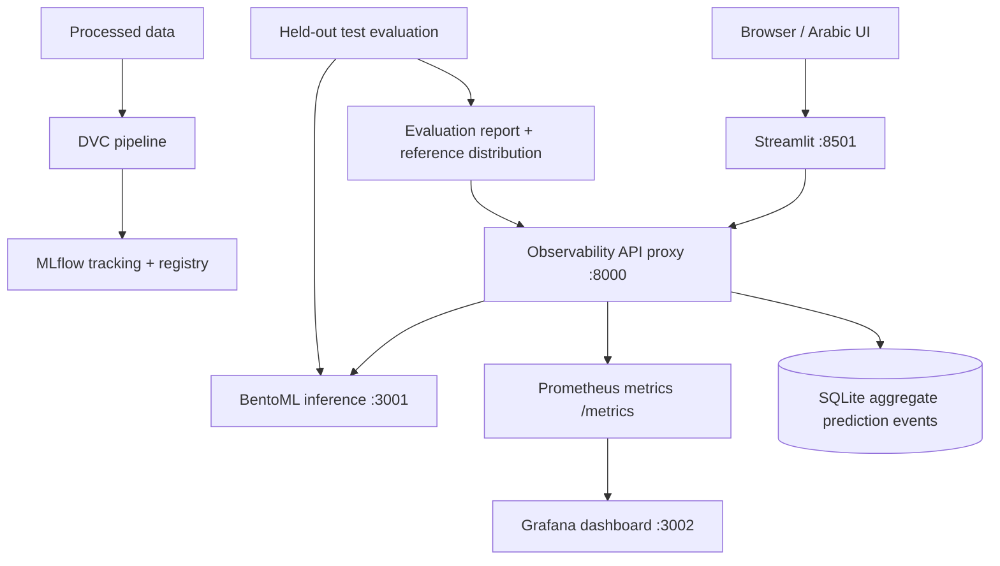

# Arabic Sentiment MLOps

End-to-end MLOps project for three-class Arabic sentiment classification using AraBERT, DVC, MLflow, BentoML, Docker, Prometheus, Grafana, and Streamlit.

**Labels:** `NEGATIVE`, `NEUTRAL`, `POSITIVE`  
**Task:** classify Arabic customer-review text and return the predicted label and confidence.

> **Status note:** The MLflow/RustFS/PostgreSQL stack and the BentoML image have been exercised locally. The UI and observability stack are added as a separate local Compose project. The served-model evaluation, Locust load test, and Grafana/alert behavior must be run on the actual machine and reported from their generated artifacts; do not treat sample or offline-training metrics as proof of serving performance.

## Architecture



The serving proxy measures end-to-end HTTP latency, request/error counts, output-label distribution, returned confidence, input text-length distribution, and population stability index (PSI). It does **not** persist raw review text. The initial drift baseline is intentionally empty: generate it only after a successful evaluation of the complete held-out test set through the real HTTP serving path.

## Model quality

The saved training/tuning report records **test accuracy 0.8757** and **macro-F1 0.8681** for the evaluated checkpoint. These are offline report values; run the serving evaluation below to verify the model artifact actually loaded by BentoML. The neutral class should be watched separately because the saved report's neutral F1 is about 0.829.

## Start the local demo

Requirements: Windows with Docker Desktop, Python 3.12 and `uv`; a successfully built BentoML image/model; processed test data available locally for offline evaluation.

### 1. Start BentoML

The BentoML model image is built on the machine that has the saved BentoML model artifact. List available images/tags using `docker images` and start the image you built, mapping host port 3001 to container port 3000. Example for the previously tested local image (use the current tag shown on your machine):

```powershell
docker run --rm --name arabic-sentiment-bento -p 3001:3000 arabic-sentiment-service:3dv67lgkh26m2aav
```

In a second terminal, verify `Invoke-RestMethod http://127.0.0.1:3001/readyz` returns HTTP 200. If the example image tag is not present, use the tag shown by `docker images`/`uv run bentoml list` for your own build.

### 2. Start the UI and observability stack

Run from the repository root. This is a separate Compose project and does not restart the MLflow/RustFS/PostgreSQL services.

```powershell
docker compose -f docker/docker-compose.observability.yml up -d --build
```

Open:

| Component | Local URL |
|---|---|
| Arabic sentiment UI | http://127.0.0.1:8501 |
| Observability proxy health | http://127.0.0.1:8000/health |
| Prometheus metrics | http://127.0.0.1:8000/metrics |
| Prometheus | http://127.0.0.1:9090 |
| Grafana dashboard | http://127.0.0.1:3002 |

Grafana's default local login is `admin` / `local-change-me`. Set `GRAFANA_ADMIN_PASSWORD` in your PowerShell session before launching for a different password. These endpoints are bound to loopback for local development; do not expose them to the public Internet with local demo settings.

### 3. Verify the containers

```powershell
docker compose -f docker/docker-compose.observability.yml ps
Invoke-RestMethod http://127.0.0.1:8000/health
(Invoke-WebRequest http://127.0.0.1:8000/metrics).StatusCode
```

Expected proxy health response: `status=ok`, `upstream_ok=true`. The Prometheus target should show `UP` at http://127.0.0.1:9090/targets.

## Evaluate the served API

Run the smoke test first; it evaluates a small subset and **does not** set the drift baseline:

```powershell
uv run python scripts/evaluate_served_model.py --limit 32 --batch-size 4
```

Once stable, evaluate the complete held-out test split in batches of at most 8:

```powershell
uv run python scripts/evaluate_served_model.py --batch-size 8 --retries 5
uv run python scripts/quality_gate.py reports/serving/api_evaluation.json
```

Generated artifacts:

- `reports/serving/api_evaluation.json` — accuracy, macro-F1, per-class F1, confusion matrix, average confidence, and HTTP batch latency percentiles.
- `reports/serving/api_test_predictions.csv` — row index, actual/predicted labels, confidence, and text length; raw review text is not saved.
- `monitoring/reference_distribution.json` — label and text-length baseline created only after a complete successful test-set run.

The quality gate uses an initial project release floor of macro-F1 ≥ 0.85 and neutral F1 ≥ 0.80. Treat it as a conservative acceptance rule, not a universal benchmark. If the gate fails, investigate the deployed model version and serving parity instead of editing the metrics to force a pass.

When the reference JSON is generated/updated, recreate the proxy so it reliably loads the evaluated baseline:

```powershell
docker compose -f docker/docker-compose.observability.yml up -d --build --force-recreate inference-proxy
```

## Load testing

First run a short test with a small number of users. Do not start with 100 users while serving errors are still present.

```powershell
New-Item -ItemType Directory -Force reports/locust | Out-Null
uv run --with locust locust -f loadtest/locustfile.py --host http://127.0.0.1:8000 --users 10 --spawn-rate 2 --run-time 60s --headless --csv reports/locust/smoke
```

Increase gradually (10 → 25 → 50 → 100 concurrent users) only while the service remains stable. Record p50/p95/p99, requests/second, failure rate, user count, hardware, and the point where latency rises sharply. Locust CSV files should be saved under `reports/locust/` and summarized in the report. A tested load level is a measurement, not a promise of capacity under all conditions.

## Training, tracking, and data versioning

The project uses `uv` for its Python environment, DVC stages in `dvc.yaml`, MLflow for experiment tracking and registry, and a Docker Compose stack for the MLflow tracking server, PostgreSQL, and RustFS artifact storage. Start that infrastructure separately using your configured `.env` file:

```powershell
docker compose --env-file .env -f docker/docker-compose.yml --project-directory . up -d
uv run dvc status
uv run dvc repro
```

Do not commit `.env`, access keys, credentials, `.venv`, caches, or raw dataset files. Follow the DVC remote workflow documented for your repository before expecting a clean clone to retrieve the data artifacts.

## Tests and CI

```powershell
uv run ruff format scripts monitoring loadtest ui
uv run ruff check src tests scripts monitoring loadtest ui
uv run pytest -q
uv run python -m compileall src serving ui scripts monitoring loadtest
```

GitHub Actions runs linting and tests on branch pushes and pull requests targeting `main`. It runs the serving quality gate when a complete `reports/serving/api_evaluation.json` report is committed. The CI job does not download the private/local trained model or reproduce GPU training.

## Resource checks

```powershell
docker stats
nvidia-smi --query-gpu=name,temperature.gpu,memory.used,memory.total,utilization.gpu --format=csv
```

Record hardware alongside results. Do not claim that the BentoML container uses the host GPU unless GPU access is configured and observed during inference. Request latency from Prometheus is end-to-end proxy latency, not isolated neural-network forward-pass time.

## Stop the demo only

```powershell
docker compose -f docker/docker-compose.observability.yml down
```

This stops only the UI/observability Compose project and preserves its named volumes. It does not stop the separate MLflow/RustFS/PostgreSQL Compose stack or unrelated containers.

## Current limitations and next steps

- TensorRT FP16 / Triton benchmarking, ONNX INT8 benchmarking, and model distillation require measured artifacts before they can be marked complete.
- The dashboard currently monitors request and prediction-distribution metrics. It does not imply that external Slack/email notifications are configured.
- PSI is an early-warning metric; investigate a labeled sample before retraining or claiming an accuracy drop.
- Public cloud deployment and a public demo URL require a separate hosting choice, secrets/network configuration, and verification. Localhost is not a public deployment.
- Complete the handbook's required PR/peer-review process and attach reports/screenshots before claiming full rubric compliance.
